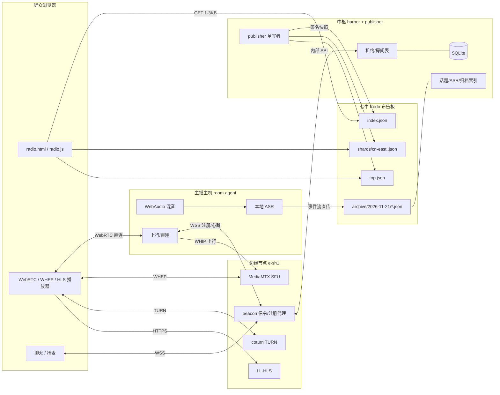
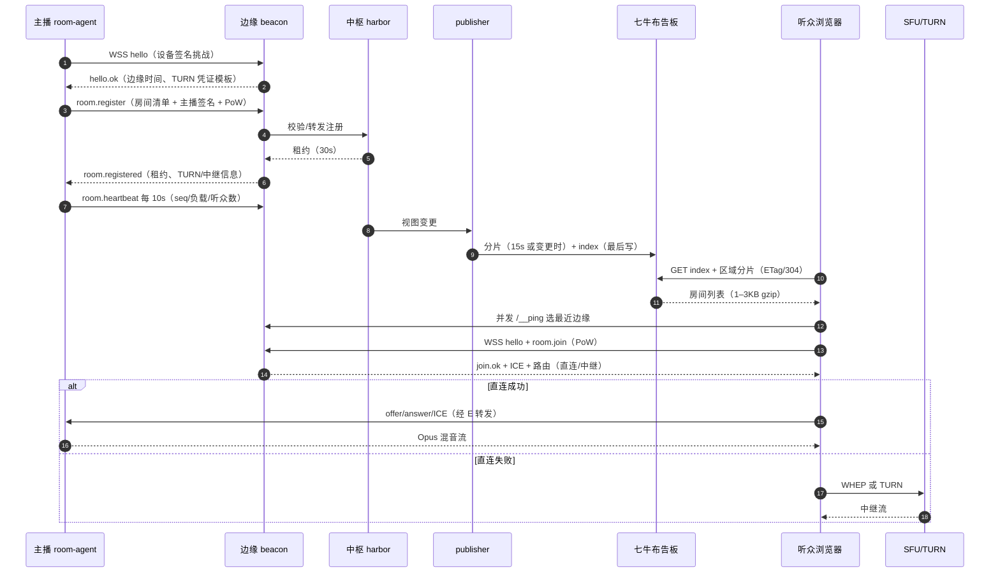
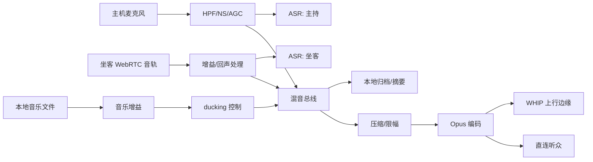

# 深夜巡航 P2P 电台网络与主播注册体系 · 技术方案

> **文档性质**：技术设计（非需求文档）。关联需求：`02_P2P实时电台.md`、`03_会话橱窗&算力租赁.md`、`04_跨窗口会话共享上下文.md`、`05_大屏多窗口优化.md`。
>
> **版本**：v0.1 草案 · 2026-11-22
>
> **适用现状**：官网为七牛 Kodo 上的纯静态站点（`site/` + `data/releases.json`，无服务端）；手头有 1 台 **阿里云 99 元/年经济型 e 实例**（2 vCPU / 2 GB / **3 Mbps 固定带宽** / 40 GB ESSD Entry / 1 个公网 IP，购买页标注“不限流量”，以实际条款为准）；域名 `partyplay.top` 已备案；主播端是 Electron 桌面应用。
>
> **一句话方案**：**用七牛 OSS（本项目即 Kodo）做“只读布告板”，用 ECS 做“会过期的注册租约 + 信令 + 必要时中转”，用 WebRTC 让听众直连主播，用 TURN/SFU/LL-HLS 分级兜底，用客户端测速代替 GeoDNS，用 OSS 直传凭证把归档流量从 ECS 挪走。**

---

## 0. 结论先行

### 0.1 五个关键决策

| # | 决策 | 解决的问题 | 代价/边界 |
|---|---|---|---|
| D1 | **注册与发现分离**：主播向边缘节点注册“软状态租约”，发布器把租约物化成签名静态快照写入七牛 OSS；听众只读 CDN/OSS 快照发现房间 | 静态站没有服务端、不能接收注册；低带宽用户需要极小首包 | 布告板有 10–30 秒最终一致延迟；需要发布器单写者 |
| D2 | **布告板默认不写原始 IP**，只写“房间元数据 + 边缘接入点 + 连接提示”；听众加入时由边缘下发新鲜的 ICE/接入信息，必要时才回传主播端点 | IP 会变、会暴露主播家庭地址、会被爬虫/DDoS 利用；CDN 缓存会放大陈旧 IP | 多一次信令往返（约 1 RTT）；如果产品坚持“板上有 IP”，保留可选字段并明确风险 |
| D3 | **主播是混音器**：主机麦克风 + 坐客 + 本地音乐在主播端混成一路 Opus，再分发给听众 | 听众只需收一路；SFU/中继/录音/ASR 都简化；弱网只需保一路 | 主播端要做 WebAudio 混音、回声控制；坐客需要一条独立回传 |
| D4 | **直连优先，四级降级**：WebRTC 直连 → TURN 中继 → 边缘 SFU/WHEP → LL-HLS 只读 | 家庭宽带/CGNAT/企业网差异大，单一方案必然有失败率 | 需要维护三条兜底路径；HLS 有 2–6 秒延迟且不能抢麦 |
| D5 | **单 ECS 起步，边缘无状态横向扩**：一台 2C2G/3 Mbps 机器跑“注册 + 信令 + TURN + 布告板发布”，SFU 后置；扩容只加“信令 + TURN + 可选 SFU”边缘，客户端测速选最近边缘，不买 GeoDNS/负载均衡 | 99 元/年就能开张；避免一开始就上 K8s/Redis 集群 | 3 Mbps 只能承载约 50–60 路中继；中枢仍是单点；P1 用 SQLite + 对象存储备份做低成本容灾 |

### 0.2 目标指标（MVP 验收口径）

| 指标 | 目标 | 说明 |
|---|---|---|
| 冷启动发现 | 4G 下首屏房间列表 < 1.5 s；2G/弱网 < 4 s | 布告板首包 ≤ 3 KB（gzip），只取 index + 1 个分片 |
| 布告板新鲜度 | p95 ≤ 30 s | 心跳 10 s、快照 15 s、缓存 5–10 s |
| 加入成功率 | ≥ 95%（直连 + 中继） | 分网络类型统计，不掩盖失败 |
| 直连比例 | ≥ 70%，目标 80% | 3 Mbps 机器上直连率是生命线：200 人 75% 直连才刚好 50 路中继 |
| 首帧音频 | p50 < 1.5 s，p95 < 4 s（4G） | 从点击房间到听到声音 |
| 端到端延迟 | 直连 < 400 ms，中继 < 800 ms | 语音电台可接受；HLS 另算 |
| 单 ECS 容量 | **3 Mbps 下约 50–60 路 32 kbps 中继**（约 2.1–2.5 Mbps，留控制/突发余量）；24 kbps 语音约 70–80 路；直连不占媒体带宽 | 3 Mbps 是硬上限，不是 CPU；2 GB 内存是第二约束 |
| 成本 | 主 ECS **99 元/年**（3 Mbps 固定、不限流量，按购买页条款）；MVP 几乎无额外流量费；扩边缘按 99–300 元/年/台 | 不含域名/证书（免费）/人力/内容审核 |

### 0.3 明确不做

- **不做全网 DHT**：浏览器 DHT 支持差、首包慢、NAT 穿透弱、无法审核；本方案用“中心注册 + 静态布告板 + P2P 媒体”的混合结构。
- **不要求主播有公网 IP**：有公网 IP/IPv6 则直连，没有就中继；开播不依赖端口映射。
- **不把聊天/ASR/归档塞进媒体服务器**：媒体走媒体面，数据走中枢与 OSS，避免互相拖垮。
- **不设计任何会中断大模型在途请求的网络超时**：连接建立、心跳、重连是传输层行为；断线只影响链路，任务可恢复，不取消模型调用；用量只用于展示/结算，不做请求门控（与仓库全局规则一致）。

### 0.4 这台 3 Mbps / 2C2G 机器能做什么

| 能做（P0） | 不能做 / 要后置 |
|---|---|
| 50 个房间的注册、心跳、信令、布告板发布 | 500+ 人同时中继（出口不够） |
| 150 人 / 70% 直连；200 人 / 75% 直连（约 50 路中继） | 200 人但直连只有 55%（90 路中继，超卖） |
| 50 路 TURN 1:1 中继；聊天/抢麦/预约/归档索引 | 同机同时跑满 TURN + SFU + HLS + 转码 |
| 主播端本地混音/ASR/摘要（吃主播的 CPU） | 在 ECS 上跑 ASR/大模型/视频转码（2C2G 不够） |
| 七牛布告板 + OSS 事件流 + 静态官网 | 3k 并发（需 CDN HLS 或 ~8 台 5 Mbps 边缘） |

> 一句话：**这台机器是“注册 + 信令 + 50 路兜底中继”的起点，不是媒体集群。** 先靠直连把 150–200 人跑稳，再按数据加边缘。

---

## 1. 现状、约束与需求映射

### 1.1 现状盘点

| 资产 | 现状 | 对本方案的含义 |
|---|---|---|
| 官网 | `site/` 三个静态页；同源读取 `data/releases.json`；七牛 Kodo 静态托管；`npm run site:deploy` 上传 `site/**` 与清单 | 官网继续静态；电台页新增 `site/radio.html`；**直播布告板不能放在 `site/` 里被站点发布覆盖**，要独立命名空间 |
| 发布脚本 | `scripts/site-release.mjs` 计算版本、SHA-256、上传、发布锁 | 可复用其七牛 SDK/配置读取；电台发布器必须用**独立的、最小权限的七牛子账号**和独立锁 |
| 服务端 | 暂无 | 本方案新增 `beacon`/`harbor`/`publisher`（逻辑三角色，P0 可同机） |
| 计算资源 | 阿里云 99 元/年经济型 e 实例：2C2G、3 Mbps 固定带宽、40 GB ESSD、1 个公网 IP | P0 全角色但**合并进程、跳过 SFU**；P1 再加 1–2 台轻量边缘；“不限流量”不等于“不限并发”，3 Mbps 是硬顶 |
| 域名/证书 | `partyplay.top` 已备案；官网子域已有 90 天证书流程 | API/边缘需要 `*.link.partyplay.top` 通配证书；建议 acme.sh DNS-01 自动续期 |
| 主播端 | Electron；可跑 WebRTC、WebAudio、本地 ASR、文件上传 | 主播端做 `room-agent`：注册、混音、直连、上行 SFU、ASR、归档 |
| 听众端 | 现代浏览器（Chrome/Edge/Safari） | WebRTC + WebSocket + MSE/HLS；不假设能装插件 |

### 1.2 硬约束

1. **官网是只读静态站**：不能接受注册、不能发 token、不能做服务端渲染；七牛 OSS 的写凭证绝不能进浏览器。
2. **浏览器网络环境不可控**：NAT/CGNAT、企业 UDP 封锁、代理、移动网络切换、iOS 自动播放限制。
3. **主播家庭上行有限**：常见 20–100 Mbps 下行、20–30 Mbps 上行；Wi-Fi 抖动；不能假设能服务上百路。
4. **本机出口只有 3 Mbps**：约 50–60 路 32 kbps 中继就到顶；直连比例决定能装多少听众。阿里云 99 元档是“固定带宽、不限流量”，不是“不限并发”。
5. **2 GB 内存要省着用**：beacon/harbor/publisher 合并成一个进程、SQLite 落盘；不要在这台机器上跑转码/录播/大模型。
6. **合规**：ICP/公安备案、聊天与语音内容审核、手机号个人信息保护、音乐公开传播版权。
7. **仓库规则**：不设置大模型请求超时、不设置请求数/用量门控；长任务只能由用户取消或真实错误终止。网络设计必须与这条一致。

### 1.3 四篇需求对网络的诉求

| 需求 | 网络/系统能力 | 本方案落点 |
|---|---|---|
| 02 实时电台：主播开房、听众静音加入、抢麦读秒、聊天板、ASR 知识库、TTS 值守、DJ 歌单、预告预约、下播事件流、历史聊天板/最热话题 | 低延迟音频、房间状态、麦位仲裁、文本广播、事件归档、预约触达 | 媒体面（WebRTC/TURN/SFU/HLS）+ 控制面（WSS 房间/麦位/聊天）+ 数据面（harbor/OSS 事件流） |
| 03 匿名身份、会话橱窗、算力租赁 | 稳定可验证身份、产物上传、任务派发、租约计量、隔离 | `node_id` + 设备密钥 + 签名；OSS 直传凭证（七牛 uploadToken）；worker 出站注册；信任域隔离 |
| 04 跨窗口共享上下文：web/desktop 差异、rrweb 录制、远程输入 | 可靠有序的低带宽数据流、E2EE、输入授权、可中断 | WebRTC DataChannel/WSS 数据流 + E2EE + 输入命令通道（与电台媒体面分离） |
| 05 大屏多窗口：子 agent 可视化、远程算力窗口 | 多流订阅、窗口级 QoS、后台节流 | `stream_id` 订阅租约 + 活跃窗口全量/后台关键帧 + 资源预算 |

**共同底座**只有四件事：**身份、发现、可达、同步**。本方案把这四件事做成一套可复用的“深夜巡航链路”，电台只是第一个应用。

---

## 2. 目标与非目标

### 2.1 目标

- **G1 低带宽可发现**：弱网首包极小；布告板可 OSS/CDN 缓存；不依赖 WebSocket 才能看到“谁在播”。
- **G2 就近可达**：听众优先连近的**主播**（网络 RTT 近，不是地图近）；直连失败时连近的**边缘**中转。
- **G3 主播零运维开播**：不要求公网 IP、不要求端口映射、不要求会配 TURN；桌面端点“开播”即可。
- **G4 成本可控**：直连优先；SFU 单流分发；归档走 OSS 直传；发现走静态 OSS/CDN；扩容按需加轻量节点。
- **G5 可运营**：布告板可回滚；边缘可摘除；房间可封禁；指标可观测；故障可降级。
- **G6 可演进**：同一套身份/信令/数据面能承载会话共享、算力租赁、多窗口播放，不重复造轮子。

### 2.2 非目标

- 不做纯去中心化（无中心注册）网络；不做跨运营商公网组播；不做 4K 视频。
- 不做“匿名到运营者也不可见”的强匿名；运营者仍需承担内容安全与合规责任。
- 不把 HLS 当互动路径；HLS 只服务“只听不说”的弱网/大并发场景。
- 不在本期实现完整支付/结算；算力租赁只预留计费事件与信任域。

---

## 3. 总体架构

### 3.1 角色与职责

| 角色 | 部署位置 | 职责 | 信任级别 |
|---|---|---|---|
| **主播（Anchor / room-agent）** | 主播主机（Electron） | 开房/注册/心跳；混音；直连听众；向边缘上行；本地 ASR；归档上报；麦位控制 | 半可信：平台校验其签名与配额，但不信任其内容 |
| **听众（Listener）** | 浏览器 | 读布告板；测速选边缘；加入；播放；聊天；抢麦；上报质量 | 不可信：PoW、限流、审核、Token |
| **边缘（Edge / beacon）** | 多地域轻量节点 | WSS 信令；注册代理；租约续期；加入票据；TURN 凭证；边缘分片发布；质量聚合 | 可信基础设施 |
| **中枢（Hub / harbor）** | 主 ECS | 注册权威；租约表；房间状态；聊天/话题；事件入库；布告板视图；封禁/审核 | 可信核心 |
| **发布器（Publisher）** | 主 ECS（可独立进程） | 单写者；把中枢视图物化为签名快照；写七牛；版本/回滚/GC | 持有七牛最小权限密钥 |
| **布告板（Board）** | 七牛 Kodo | 只读、可缓存、可分片的房间/预告/归档/热门 JSON | 公开可读；写入仅发布器 |
| **媒体服务（SFU/TURN）** | 边缘/主 ECS | MediaMTX：WHIP 收流、WHEP 分发、LL-HLS；coturn：STUN/TURN | 可信基础设施；不解析业务内容 |
| **值守 Agent（Bot）** | 未来：边缘或主播端 | 读取知识库，TTS 发言，24h 值守；以 guest 身份加入并标注 AI | 受限：不可冒充真人，不可抢主持人麦 |

> P0 阶段 Edge/Hub/Publisher 合并成一个 `core` 进程跑在同一台 2C2G ECS 上；coturn 必装；MediaMTX SFU 在 P0 可不装（先 TURN 兜底），P1 视内存/需求再加。逻辑角色仍分开，便于后续拆机。

### 3.2 四平面

```
┌─────────────────────────────────────────────────────────────────────┐
│ 发现平面（只读、可缓存、低带宽）                                      │
│   七牛 OSS：index.json + 区域分片 + top.json + archive/*.json         │
│   可选：边缘 /api/v1/board 实时兜底                                    │
└─────────────────────────────────────────────────────────────────────┘
┌─────────────────────────────────────────────────────────────────────┐
│ 控制平面（长连接、软状态、可重连）                                     │
│   WSS：注册/心跳/加入/信令/聊天/麦位/质量上报                          │
│   HTTP：测速 /__ping、预约、举报、直传凭证、健康检查                   │
└─────────────────────────────────────────────────────────────────────┘
┌─────────────────────────────────────────────────────────────────────┐
│ 媒体平面（低延迟、可降级）                                             │
│   直连 WebRTC（Opus）→ TURN 中继 → 边缘 SFU/WHEP → LL-HLS 只读        │
└─────────────────────────────────────────────────────────────────────┘
┌─────────────────────────────────────────────────────────────────────┐
│ 数据平面（可靠、可归档、与媒体解耦）                                   │
│   harbor：聊天/话题/租约/事件索引；OSS：事件流/归档/知识库原文        │
│   会话共享：rrweb 事件流（E2EE，DataChannel/WSS）；租赁：任务/回执     │
└─────────────────────────────────────────────────────────────────────┘
```

### 3.3 逻辑架构图



**读图要点**：

- 布告板只在“发现”时读；进入房间后靠 WSS 推送状态，不再高频轮询 OSS。
- 主播始终与边缘保持一条控制连接和一条媒体上行（即使全是直连听众），用于中继、归档、值守、监控。
- 媒体不经过 harbor；聊天/ASR 不经过 SFU；各平面互不阻塞。

### 3.4 一次开播到收听的时序



### 3.5 为什么不是纯 P2P / DHT

| 方案 | 发现速度 | NAT 穿透 | 内容审核 | 成本 | 结论 |
|---|---|---|---|---|---|
| 纯 DHT（Kademlia/WebTorrent） | 慢，需 bootstrap，浏览器支持差 | 弱，需额外 relay | 几乎不可行 | 低（但工程/合规成本高） | 不适合电台 |
| 纯中心媒体（全部过 ECS） | 快 | 无问题 | 容易 | 带宽最贵，单点 | 只作为兜底 |
| 中心注册 + 静态布告板 + P2P 媒体（本方案） | 快（只读 CDN） | 直连 + TURN/SFU 兜底 | 可控 | 直连省带宽，扩容便宜 | **选用** |
| 商业 RTC（声网/即构/TRTC） | 最快 | 厂商负责 | 厂商能力 | 按分钟计费，规模上来不便宜；数据出境/合规需评估 | 备选，不作为默认 |

---

## 4. 身份、信任与匿名

### 4.1 身份模型：稳定节点 + 指纹承诺

需求 03 说“始终以 dsh 的指纹识别你，而非匿名名字和头像”。这里有一个工程细节：**如果把指纹（含本地模型使用数据）直接哈希成主键，用户换模型、清缓存、升级后指纹变化，身份就漂移了**。因此采用“稳定种子 + 指纹承诺”的两层模型：

```
identity_seed（首次运行生成，32B，存 OS Keychain）
        │
        ├─ Ed25519 keypair（seed → pubkey）
        │
        ├─ node_id = "nc1_" + base32(SHA-256(pubkey)[:16])
        │        // 自证明：边缘可用 pubkey 直接校验 node_id，不能抢注
        │
        └─ fingerprint_commitment = HKDF-SHA256(fingerprint, seed, "nc/fp/v1")
                 → 只上传承诺值，不上传原始指纹/使用数据
```

- **node_id**：公开、稳定、可自证明（由公钥哈希得到），用于房间归属、信誉、跨端识别。
- **fingerprint_commitment**：证明“这台机器/这套模型使用画像”与 node_id 的绑定；用于去重、反作弊、信誉。原始指纹只在本机计算。
- **身份轮换**：换机/重装时，用旧设备密钥签一条 `identity.rotate`，把旧 node_id 的信誉迁移到新 node_id；没有旧密钥则视为新身份。
- **多端**：同一自然人可在多台机器上有多个 node_id；后续可用二维码/一次性码做“可信设备绑定”，不强制。

> 这样既满足“你即 agent、agent 即你”的产品语义，又避免模型使用数据变化导致身份不稳定，也避免把敏感画像公开。对产品而言，平台认的仍是“你的机器 + 模型使用画像”，不是昵称/头像；只是把原始画像留在本机，只上传承诺值。
>
> **边界**：这是设备自证，不是硬件级远程证明。它能防止“随口换名/抢注 node_id”，但不能阻止有心人重装换身份；需要更强时接 TPM/安全 enclave/平台账号，并配合 IP 段、行为信誉做风控。

### 4.2 密钥与签名

| 密钥 | 算法 | 存放 | 用途 |
|---|---|---|---|
| 主播设备密钥 | Ed25519 | Electron `safeStorage` / OS Keychain | 签房间清单、心跳、事件流、任务回执 |
| 听众临时密钥 | P-256/Ed25519 | 浏览器内存（可选） | 会话共享 E2EE、输入命令签名 |
| 边缘节点密钥 | Ed25519（签名）+ mTLS（X.509/ECDSA） | 边缘配置（0600） | 边缘↔中枢双向认证 |
| 发布器密钥 | Ed25519 或 P-256 | 主 ECS secret（0600） | 签布告板快照 |
| 布告板根公钥 | Ed25519/P-256 | 静态站 JS 内置 + 文档 | 浏览器验签；季度轮换，保留上一把 |

- **规范化**：签名前用 RFC 8785 JCS 规范化 JSON，签 SHA-256 摘要，base64url 编码。
- **首次注册（自证明）**：主播提交 `pubkey + fingerprint_commitment + 设备签名`；边缘校验 `node_id == H(pubkey)`，因此不能抢注别人的 node_id；harbor 记录公钥绑定。换设备/换钥必须用旧钥签 `identity.rotate`，否则视为新身份；这样注册体系不依赖中心发证，也能防随意冒名。
- **浏览器验签**：优先 Ed25519（2025 年起 Chrome/Edge/Firefox/Safari 已陆续支持）；检测失败回退 P-256。验签失败时**不渲染房间列表**，显示“布告板校验失败”，避免被投毒。
- **实话**：如果攻击者能改七牛里的 JS，也能改验签逻辑；布告板签名主要防“部分写权限泄露/中间缓存篡改/第三方镜像”，不是万能的。

### 4.3 匿名资料

- 听众只需一个名字 + 头像即可发帖/聊天；默认生成“听众####”，头像用 `node_id` 派生的 CSS 渐变/emoji，不上传图片，省带宽也省审核。
- 主播可自定义头像/封面，走 OSS 上传 + 内容审核；未审核通过不展示。
- 聊天/房间标题的展示名与 node_id 解耦：同一 node_id 可在不同房间用不同昵称，但信誉跟随 node_id。

### 4.4 反滥用

| 手段 | 说明 |
|---|---|
| PoW | 注册/首次发言/预约需解一道 SHA-256 难度 12–16 的哈希题；弱网可降到 10，服务端按 IP 动态调 |
| 速率限制 | 连接/房间/IP/节点四级令牌桶；聊天 1 条/2 s、20 条/分钟；注册 1 房间/节点 |
| 信誉 | 被举报/封禁/频繁断线降权；低信誉房间不进“推荐”，仅保留直链 |
| 封禁 | 按 node_id + IP 段 + 设备密钥指纹；支持房间级、主播级、全站级 |
| 审核 | 标题/聊天/ASR 文本关键词 + 模型审核 + 人工复核；先发后审 + 举报下架 |
| 配额 | 每主播并发房间 1；每房间听众上限由主播上行/边缘容量决定；TURN 每用户配额 |

### 4.5 隐私边界

| 数据 | 浏览器 | 边缘 | 中枢 | OSS 布告板 | 保留 |
|---|---|---|---|---|---|
| 原始 dsh 指纹 | 本机计算 | 不接收 | 不接收 | 不写 | — |
| fingerprint_commitment | 可计算 | 接收 | 存 | 不写 | 账号生命周期 |
| node_id / 公钥 | 有 | 有 | 有 | 主播房间可见 | 长期 |
| 主播公网 IP | 不直接下发（默认） | 可见 | 可见 | 不写（默认） | 短期日志 |
| 听众 IP | — | 可见 | 截断/哈希 | 不写 | 30 天 |
| 手机号 | 表单 | 加密转发 | 加密存 | **绝不写** | 下播后 7 天删除 |
| 聊天/ASR 文本 | 有 | 转发 | 存/索引 | 归档（可选） | 30–90 天 |
| 音频 | 有 | 中继不落盘 | 不落盘 | 不存（除非主播选择录播） | — |

---

## 5. 注册体系：租约、软状态与布告板

这是整个方案的核心。把“注册”理解成**有 TTL 的租约**，把“布告板”理解成**租约表的一个只读物化视图**，很多一致性问题就简单了。

### 5.1 状态模型

```
scheduled ──(到点/主播开播)──> live ──(主播下播)──> ended
     │                          │  │
     │                          │  └─(心跳丢失 30s)──> stale ──(90s)──> offline(墓碑)
     │                          │
     └─(取消)───────────────────┴──> cancelled
```

| 状态 | 是否进布告板 | 是否可加入 | 说明 |
|---|---|---|---|
| `scheduled` | 是（预告板） | 否（可预约） | 有 `start_at`，长 TTL |
| `live` | 是（直播板） | 是 | 租约有效，媒体可用 |
| `stale` | 是（标灰） | 可尝试 | 心跳丢失但未超墓碑；边缘会尝试重连 |
| `ended` | 归档板 | 否 | 可看聊天回放/摘要 |
| `cancelled` | 短暂墓碑 | 否 | 10 分钟后消失 |
| `banned` | 否 | 否 | 审核/封禁 |

**租约字段**：

```json
{
  "room_id": "r_7Q2M9K4T2A",
  "anchor_id": "nc1_...",
  "edge_id": "e-sh1",
  "epoch": 3,
  "state": "live",
  "expires_at": "2026-11-22T00:41:30+08:00",
  "seq": 42,
  "route": { "privacy": "relay", "edges": ["e-sh1", "e-gz1"], "direct": false }
}
```

- **epoch**：主播每次启动/重连 +1；旧 epoch 的心跳/事件一律丢弃，避免“幽灵房间”。
- **seq**：房间内状态变更单调递增；聊天/麦位/事件都带 seq。
- **TTL 30 s**，心跳 10 s；连续丢 3 次进入 `stale`；90 s 未恢复进 `offline` 并写墓碑。
- **软状态**：边缘/中枢不“删除”房间，只让租约过期；所有清理都是幂等的。

### 5.2 写路径：从主播到布告板

```
主播 room-agent
   │ 1. WSS hello（设备签名挑战，拿短时 token）
   ▼
边缘 beacon ──2. 校验 schema/签名/PoW/限流/标题预审
   │ 3. 内部 API（mTLS 或 WireGuard）
   ▼
中枢 harbor ──4. 幂等 upsert 租约；房间状态机；写 SQLite
   │ 5. 视图变更（去抖 1–5s）
   ▼
publisher（单写者）──6. 生成区域分片；JCS 规范化；签名
   │ 7. PUT 分片对象（不可变 key，含 board_seq）
   │ 8. 最后 PUT index.json（提交点）
   ▼
七牛 Kodo / CDN
```

**关键规则**：

1. **只有 publisher 能写布告板**。浏览器、主播、边缘都没有七牛写权限。
2. **分片先写、index 后写**：index 是提交点；读者不会读到“新 index + 旧分片”的撕裂状态。
3. **幂等**：`(anchor_id, epoch)` 唯一；重复注册返回当前租约；重复心跳按 seq 丢弃。
4. **校验**：schema 版本、房间归属（node_id 与签名公钥一致）、标题/标签长度与敏感词、容量上限、每主播房间数、IP 信誉。
5. **失败处理**：任一分片 PUT 失败 → 不更新 index，保留上一版；publisher 重试并告警；连续 3 次失败进入只读降级。
6. **单写者**：publisher 启动时在 SQLite `publisher_lease` 表抢租约（`BEGIN IMMEDIATE`），只有 leader 写；多实例时非 leader 待命。
7. **命名空间隔离**：布告板写在 `data/radio/**`，官网发布只写 `site/**` 与 `data/releases.json`；`site:deploy` 必须显式拒绝 `site/data/radio`，防止本地旧快照覆盖线上。

### 5.3 读路径：低带宽发现

```
radio.html
  │ 1. GET /data/radio/v1/index.json（ETag/If-None-Match）
  │ 2. 选区域（本地缓存/时区/语言/边缘测速结果）
  │ 3. GET /data/radio/v1/shards/cn-east.<seq>.json（不可变，长缓存）
  │ 4. 渲染房间卡片；点击后 WSS 加入
  ▼
失败兜底：
  - index 404/过期 → GET 最近边缘 /api/v1/board?region=...
  - 边缘也失败 → localStorage 上次成功快照（标记“非实时”）
```

- **同源**：布告板与官网同域，避免 CORS 与额外 TLS 握手。
- **ETag/304**：index 每次可能变，用条件请求；分片不可变，命中缓存直接 304/200 from cache。
- **只取需要的一个分片**：不拉全站；区域判断错时最多多拉一个。
- **进入房间后停止轮询**：边缘通过 WSS 推 `room.state`/`board.patch`；大厅页仅在可见时 60 s 轮询一次。
- **时钟**：用边缘 `hello.ok.server_ts` 校正；`as_of` 超过 TTL 标“可能已结束”；超过 90 s 强制走实时 API。

### 5.4 对象布局与缓存策略

| Key | 内容 | 大小（目标） | Cache-Control | 写入频率 |
|---|---|---|---|---|
| `data/radio/v1/index.json` | 版本、`board_seq`、边缘列表、分片指针、签名 | 1–2 KB | `public, max-age=5, stale-while-revalidate=25, stale-if-error=300` | 15 s 或变更 |
| `data/radio/v1/shards/{region}.{seq}.json` | 该区域房间列表（完整） | 10–40 KB（gzip 3–10 KB） | `public, max-age=31536000, immutable` | 15 s（新 key） |
| `data/radio/v1/lite/{region}.{seq}.json` | 极简列表（top 20） | 2–5 KB（gzip 1–2 KB） | 同上 | 15 s |
| `data/radio/v1/top.json` | 热门话题/房间 top 10 | 1–2 KB | `max-age=60` | 1 min |
| `data/radio/v1/schedule.{date}.json` | 预告板 | 2–10 KB | `max-age=300` | 变更时 |
| `data/radio/archive/{date}/index.json` | 当日归档索引 | 2–10 KB | `max-age=300` | 5 min |
| `data/radio/archive/{date}/{room_id}/summary.json` | 单场摘要/聊天/ASR 索引 | 5–100 KB | `immutable` | 下播后 |
| `data/radio/events/{date}/{room_id}/{epoch}/{seq}.ndjson.gz` | 事件流分块 | 64–256 KB | `immutable` | 主播直传 |
| `data/radio/keys.json` | 布告板公钥/轮换 | < 1 KB | `max-age=300` | 季度 |

**为什么分片 key 带 `board_seq`**：读者拿到 index 后分片一定还存在；不会被下一次覆盖写“换掉内容”。旧分片由生命周期规则在 1 天后删除（或保留 7 天用于审计）。对象数约 `15s × 4 区域 × 2 形态 ≈ 4.6 万/天`，小对象存储与 PUT 费用在每月几元量级，需按七牛实际计费复核。

**压缩**：七牛上传支持 `cacheControl` 与 `contentEncoding` 元数据；发布器可预压缩 JSON 并设 `contentEncoding: gzip`，也可交给 CDN 压缩（若启用 CDN）。两种都行，**上线前用 `curl -H 'Accept-Encoding: gzip' -I` 验证只压一次**，避免双重压缩。

> **当前部署现实**：官网部署手册采用 Kodo 源站域名直连，没有单独 CDN。`Cache-Control` 仍会随对象返回，浏览器按 5–10 s 缓存；Kodo 直连的延迟在国内通常可接受。若后续加七牛 CDN，把 `index.json` 设为跟随源站/5–10 s，分片长缓存；**不要**给 index 配长缓存，否则开播/下播会延迟。

### 5.5 布告板 Schema

#### index.json

```json
{
  "v": 1,
  "kind": "nc.radio.index",
  "board_seq": 88421,
  "as_of": "2026-11-22T00:40:00+08:00",
  "ttl": 30,
  "min_client": 1,
  "edges": [
    {
      "id": "e-sh1",
      "name": "上海",
      "region": "cn-east",
      "wss": "wss://e-sh1.link.partyplay.top/ws",
      "probe": "https://e-sh1.link.partyplay.top/__ping",
      "weight": 100
    }
  ],
  "shards": [
    {
      "region": "cn-east",
      "key": "data/radio/v1/shards/cn-east.88421.json",
      "lite": "data/radio/v1/lite/cn-east.88421.json",
      "rooms": 42,
      "bytes": 18320,
      "sha256": "…"
    }
  ],
  "top": "data/radio/v1/top.json",
  "keys": [
    { "kid": "board-2026q4", "alg": "Ed25519", "pub": "base64url…", "not_after": "2027-01-31" }
  ],
  "sig": { "kid": "board-2026q4", "value": "base64url…" }
}
```

#### 区域分片（完整）

```json
{
  "v": 1,
  "kind": "nc.radio.shard",
  "region": "cn-east",
  "board_seq": 88421,
  "as_of": "2026-11-22T00:40:00+08:00",
  "rooms": [
    {
      "room_id": "r_7Q2M9K4T2A",
      "anchor": {
        "node_id": "nc1_...",
        "name": "夜航员",
        "avatar": "grad:7",
        "tags": ["聊天", "合成器"]
      },
      "title": "凌晨两点的合成器电台",
      "state": "live",
      "started_at": "2026-11-22T00:10:00+08:00",
      "listeners": 37,
      "capacity": 80,
      "mic_slots": 2,
      "media": {
        "codec": "opus",
        "kbps": 32,
        "modes": ["p2p", "sfu", "hls"]
      },
      "route": {
        "privacy": "relay",
        "direct": false,
        "edges": ["e-sh1", "e-gz1"]
      },
      "join": { "pow": 12, "token": true },
      "anchor_sig": { "kid": "nc1_...", "value": "base64url…" }
    }
  ],
  "sig": { "kid": "board-2026q4", "value": "base64url…" }
}
```

#### 极简分片（`lite`）

只保留渲染卡片必需字段：`room_id`、`title`（截断 24 字）、`state`、`listeners`（取整到 5）、`capacity`、`mic_slots`、`tags`（最多 2 个）、`route.privacy`、`anchor.name`。100 个房间约 11 KB，gzip 后约 3 KB。弱网/`saveData`/`effectiveType` 为 `2g|slow-2g` 时只拉 lite。

#### 字段设计说明

- **不写**：主播 IP、端口、ICE candidate、听众昵称、聊天、手机号、精确经纬度、原始指纹。
- **`route.privacy`**：`direct`（板上有可选端点）/`relay`（只走边缘）/`hybrid`（优先直连，失败中继）。
- **`route.edges`**：主播已上行或可按需拉流的边缘列表；听众就近选一个。
- **`join.pow`**：动态难度；服务端可下发挑战，客户端解完再连。
- **`anchor_sig`**：主播对房间字段的签名；布告板发布器验证后才收录，读者可二次验证。

### 5.6 一致性与新鲜度

| 场景 | 行为 |
|---|---|
| 主播刚开播 | 心跳后 ≤15 s 出现在板；首页可能晚 5–10 s（缓存） |
| 主播异常断线 | 30 s 标 `stale`，90 s 标 `offline`；听众收到 `room.state` 或重连失败提示 |
| 主播换边缘 | 同 `room_id`、`epoch+1`；板 15 s 内更新 `route.edges`；在线听众收 `room.moved` |
| 发布器挂了 | 板停留在上一版；`as_of` 变旧；客户端 90 s 后转实时 API；告警 |
| 中枢挂了 | 边缘保留已有房间的最后一版租约；新注册失败；板不变；恢复后重放 |
| 七牛 5xx | 客户端读本地缓存并标“非实时”；官网其他页面不受影响 |
| 时钟漂移 | 用服务端时间；客户端只信 `server_ts` 与相对年龄，不用本地绝对时间排序 |

**一致性等级**：布告板是**最终一致的只读视图**，允许 10–30 s 误差；房间内的聊天/麦位/播放状态由 WSS 实时通道保证，不依赖布告板。index 每 15 s 心跳刷新 `as_of`，分片只在内容变化时重写——读者看到“新鲜的空板”和“新鲜的有内容的板”都不会误判。

### 5.7 发布频率与成本

| 项 | 数值（估算） | 说明 |
|---|---|---|
| 心跳 | 10 s/房间 | 边缘内存更新，不直接写 OSS |
| index 心跳 | 15 s，始终写 | 1–2 KB；刷新 `as_of`，避免分片没变时被误判过期 |
| 分片 | 15 s，仅变更时 | 4 区域 × 2 形态，最坏约 4.6 万对象/天 |
| PUT 请求 | 约 140 万/月（最坏） | 七牛请求费按实际单价复核，通常每月几元 |
| 对象存储 | 保留 1 天约 0.3–0.6 GB | 4 区域 × 完整+lite、每次约 96 KB、5760 次/天；生命周期 1 天，费用可忽略 |
| CDN/OSS 读 | 每次进大厅 2 个请求；大厅页约 1 次轮询/分钟 | 1000 人大厅约 6–15 万请求/小时（取决于停留与轮询），费用仍很低 |
| 归档 | 每场 0.1–5 MB 文本 | 远小于音频；音频默认不存 |

> index 心跳复用同一 `board_seq`，只更新 `as_of`；只有分片内容变更才递增 `board_seq` 并切到新 key。这样“没变化”不会造成分片重写，也不会让读者误判过期。

> 真正的成本不在布告板，而在**媒体中继流量**。所以架构上要不遗余力地提高直连比例、用 SFU 单流分发、把“只听”的大并发导到 CDN HLS。

### 5.8 低带宽专项设计

**预算表**（目标值，需真机校准）：

| 资源 | 2G（250 kbps，300 ms） | 3G（1.5 Mbps，100 ms） | 4G/Wi-Fi |
|---|---|---|---|
| HTML+CSS+JS（电台页） | ≤ 30 KB gzip | ≤ 30 KB | ≤ 30 KB |
| index | ≤ 1 KB gzip | ≤ 1 KB | ≤ 1 KB |
| 分片 | lite ≤ 2 KB；完整 ≤ 8 KB | 完整 ≤ 10 KB | 完整 ≤ 10 KB |
| 首屏可交互 | ≤ 4 s | ≤ 2 s | ≤ 1.5 s |
| 加入播放 | ≤ 8 s | ≤ 4 s | ≤ 2 s |
| 音频 | 16 kbps 单声道，DTX 开 | 24 kbps | 32 kbps（音乐 48 kbps） |

**手段**：

1. **无框架、无字体、无大图**：电台页用系统字体 + CSS 渐变头像；封面图仅在 4G/Wi-Fi 懒加载。
2. **lite 分片**：`navigator.connection.saveData` 或 `effectiveType` 为 `2g/slow-2g` 时只拉 lite，并默认 16 kbps。
3. **条件请求**：index 用 ETag；分片 immutable；`localStorage` 缓存上次成功板，离线可看。
4. **预连接**：页面空闲时 `preconnect` 到 top 2 边缘；不要预连接全部。
5. **WSS 推送代替轮询**：进房后状态走 WSS；大厅页 `visibilitychange` 时暂停轮询。
6. **聊天懒加载**：只拉最近 30 条；历史按需；头像默认不加载。
7. **错误可读**：弱网失败显示“重试/仅收听”，不要无限转圈；重试指数退避 + 抖动。
8. **首包优先**：index 与 lite 分片可内联到 `radio.html` 的 `<script type="application/json">` 作为兜底？不建议，发布耦合；用 `<link rel="preload">` 即可。

### 5.9 布告板安全

- **签名**：index/分片/top 全部签名；客户端验签；`kid` 轮换；保留上一把公钥 30 天。
- **写权限**：七牛子账号/空间授权尽量限制到 `data/radio/*`（以 IAM 实际粒度为准），只给 PUT/GET；绑定发布器出口 IP（若七牛支持）；密钥在 systemd `EnvironmentFile`（0600），不进 Git、不进浏览器。
- **与官网发布隔离**：`site:deploy` 只碰 `site/**` + `data/releases.json`；电台发布器只碰 `data/radio/**`；两边用不同的七牛子账号和锁。CI 加一条检查：`site/` 下出现 `data/radio` 直接失败。

```js
// scripts/site.mjs / site-release.mjs 的发布前断言（伪代码）
if (existsSync(join(siteRoot, 'data/radio'))) {
  throw new Error('布告板必须由 publisher 独立发布，不能放进 site/ 被站点发布覆盖')
}
```

- **回滚**：保留最近 N 个 `board_seq` 的 index 备份（本地或 OSS `data/radio/rollback/`）；发布器支持 `--rollback <seq>`；回滚也要签名。
- **防投毒**：CDN 缓存 key 固定；分片 immutable；index 短 TTL；发现异常 `sha256` 不匹配时回退上一版并告警。

### 5.10 三种板与预约

| 板 | 内容 | 写入 | 读者 |
|---|---|---|---|
| **预告板** | 未来 7 天节目：标题、主播、开始时间、预约入口、标签 | 主播排期 / 运营审核；可提前发布 | 官网首页底部滚动栏、反馈入口、电台页 |
| **直播板** | 当前 `live/stale` 房间 + 边缘负载 + 热门 | publisher 15 s | 电台页、反馈入口 |
| **归档板** | 刚结束的场次、聊天回放、ASR 摘要、最热话题 | 下播事件流 + harbor 索引 | 电台页“刚结束”、反馈入口 |

**预约流程**：

1. 静态页表单：房间/场次、手机号、同意条款、可选备注；先做 PoW + 图形/行为验证。
2. `POST https://e-sh1.link.partyplay.top/api/v1/bookings`（CORS 仅允许官网域）。
3. 边缘校验后加密（AES-GCM，密钥在 KMS/env）写 harbor；**绝不写 OSS/布告板**。
4. 主播通过 WSS `booking.new` 收到脱敏提醒；在主播端“预约管理”里按权限查看完整号码（二次确认 + 审计日志）。
5. 通知方式由主播决定：站内提醒、短信（需模板报备，按条计费）、或开播时在房间公告。默认不自动群发。
6. 下播后 7 天自动删除；用户可随时请求删除；导出/删除接口留审计。

**入口**：

- **首页底部滚动栏**：读 `index.json` + `top.json`，显示“正在播 / 10 分钟后开播 / 刚结束”，失败时静默隐藏，不阻塞下载页。
- **反馈入口**（设置/帮助页）：一个电台卡片，列出“正在播、预告、刚结束、当天最热话题”，点击直接进 `radio.html` 对应房间/归档。
- 两处都只读布告板，不各自维护状态；房间结束后由归档板接管。

### 5.11 关于“布告板上写主播 IP”的取舍

需求里说“让听众以较低速网络发现主播 IP 以发起连接”。本方案默认**不在布告板写原始 IP**，原因和替代如下：

| 方案 | 做法 | 优点 | 风险 |
|---|---|---|---|
| **A（默认）路由提示** | 板上只写 `room_id/anchor_id/route.edges/privacy`；加入时边缘返回新鲜的 ICE/端点 | IP 不随 CDN 缓存变旧；主播家庭地址不公开；可换 IP/边缘；防爬虫 | 多 1 次信令往返（约 1 RTT） |
| **B 板上直写 IP** | `route.endpoint = {host, port, proto, expires}`，TTL ≤ 30–60 s | 理论上可“零信令”直连；实现简单 | IP 漂移/缓存陈旧；主播被 DDoS/人肉；CDN 缓存与隐私冲突；NAT 后 IP 仍不可直连 |
| **C 边缘代发** | 板上有 `connect_id`，边缘 `POST /connect` 返回端点/票据 | 兼顾低带宽与新鲜度；可审计/限流 | 仍多一次请求 |

**结论**：A 是默认，C 是可选增强；B 只在“局域网/自建/主播明确同意公开 IP”时启用，并强制短 TTL、签名、`privacy=direct`。从“发现”角度，听众仍然通过 1–3 KB 的布告板发现主播的**接入点**，只是把“精确 IP”推迟到加入时由边缘下发——这既满足低带宽发现，也避免 CDN 把陈旧 IP 放大给所有人。

---

## 6. 连接建立与就近选择

### 6.1 候选与排序：什么叫“近”

“近”指**网络 RTT 低且路径稳定**，不是地图直线距离。排序输入：

| 输入 | 来源 | 权重（建议） |
|---|---|---|
| 听众→边缘 RTT | `/__ping` 并发测速（2 次取 min） | 0.30 |
| 边缘→主播 RTT | 边缘对主播 WSS 心跳的 RTT（EWMA） | 0.20 |
| 主播直连可达性 | 历史 ICE 成功率 / `route.direct` | 0.20 |
| 边缘/主播负载 | `listeners/capacity`、CPU、上行 | 0.15 |
| 区域/语言/标签匹配 | 本地偏好 + 房间标签 | 0.10 |
| 新鲜度/信誉 | `as_of`、举报率 | 0.05 |

```
# 分数越低越好；tag_match ∈ [0,1]，匹配越高惩罚越小
cost = 0.30·norm(rtt_le) + 0.20·norm(rtt_ea) + 0.20·(direct_ok ? 0 : 1)
     + 0.15·norm(load) + 0.10·(1 - tag_match) + 0.05·norm(age)
```

- 没有历史 RTT 时，用 `rtt_le + rtt_ea` 作为代理；首次连接后把真实 `rtt_listener_anchor` 写入 IndexedDB（按 room/anchor 维度 EWMA），下次排序更准。
- 显示“预计延迟”区间，不承诺精确值；直连失败自动降级，不弹错误打断。
- **主播密度不足时**：“就近”会退化为“就近边缘”；早期用排期集中开播、官方/合作主播多地域覆盖来保证可选房间；不承诺每个城市都有主播。
- **对冲连接**：用户点进房间后，先直连；1.5 s 未连上并行发起 WHEP 中继；先成功者胜出，取消另一条。避免“等 5 s 才降级”的糟糕体验。

### 6.2 边缘选择：不买 GeoDNS 也能就近

1. `index.json` 里有 `edges[]`（id、region、wss、probe、weight）。
2. 页面并行 `fetch(probe, {mode:'cors', cache:'no-store'})` 测 RTT；取前 2 个建立 WSS（第二个作为热备，不加入房间）。
3. 选 RTT 最低且 `healthy` 的边缘；失败 1 次换下一个；记录 5 分钟。
4. 边缘健康由 harbor 心跳维护；不健康时 index 里 `weight=0` 或直接移除；客户端仍有本地缓存可兜底。
5. 需要更强就近时可加阿里云 DNS 线路解析，但**客户端实测比 GeoDNS 更准**，且免费；GeoDNS 作为可选增强。

### 6.3 加入流程与状态机

```
IDLE → BOARD_LOADED → EDGE_PICKED → WSS_OPEN → JOIN_SENT → JOINED
   → ICE_GATHERING → CONNECTING → PLAYING
   ↘ FALLBACK_TURN → FALLBACK_SFU → FALLBACK_HLS → FAILED
```

| 步骤 | 超时（仅传输层） | 失败动作 |
|---|---|---|
| 布告板 | 3 s | 用缓存/实时 API |
| `/__ping` | 1.5 s | 用默认边缘 |
| WSS 连接 | 3 s | 换边缘 |
| `room.join` | 3 s | 重试 1 次；满员则提示 |
| 直连 ICE | 4 s | 并行 WHEP；TURN 兜底 |
| WHEP | 5 s | HLS |
| HLS | 8 s | 显示“仅文字聊天” |

> 这些超时**只作用于连接建立与播放**，不作用于任何大模型请求；断线重连不取消主播端/租赁端的在途任务。

### 6.4 NAT 矩阵与预期

| 主播网络 | 听众网络 | 预期 | 兜底 |
|---|---|---|---|
| 公网 IPv4 / 全锥 | 任意 | 直连成功率高 | — |
| 受限/端口受限 NAT | 任意 | STUN 后多可直连 | TURN |
| 对称 NAT / CGNAT | 任意 | 直连低 | SFU/TURN |
| 仅有 IPv6 | 有 IPv6 | 可直连（ICE 选 IPv6） | TURN/SFU |
| 企业网封 UDP | 任意 | 直连失败 | TURN/TCP 443；仍不行 → HLS |
| 代理只允许 HTTPS | 任意 | 仅 HLS/WSS 文本 | LL-HLS 只读 |

**IPv6 是一张便宜的好牌**：国内移动/教育网 IPv6 覆盖较好；边缘和主播端都启用 IPv6 后，部分 CGNAT 场景可直连。要求：边缘有 AAAA、STUN 支持 IPv6、ICE 不强制 IPv4。

### 6.5 媒体参数

| 场景 | 编码 | 码率 | 声道 | 参数 |
|---|---|---|---|---|
| 纯语音 | Opus | 16–24 kbps | 单声道 | `useinbandfec=1`、`usedtx=1`、`ptime=20` |
| 语音+音乐混合 | Opus | 32 kbps | 单声道/立体声 | DTX 关、FEC 开、`maxaveragebitrate=32000` |
| DJ 音乐优先 | Opus | 48–64 kbps | 立体声 | DTX 关、FEC 开；语音时 ducking |
| 弱网 | Opus | 12–16 kbps | 单声道 | DTX 开、FEC 开、降低 `playoutDelayHint` |

- **码率控制**：发送端用 `RTCRtpSender.setParameters({ encodings: [{ maxBitrate }] })` 做硬上限；`maxaveragebitrate`/`useinbandfec`/`usedtx` 通过 SDP fmtp 协商——注意 `maxaveragebitrate` 是接收侧参数，不要把它当成发送端开关。
- **抖动缓冲**：WebRTC 自适应 NetEQ；直播场景可设 `playoutDelayHint=0.2`（Chrome）降低延迟，弱网让浏览器自适应。
- **回声**：主播/坐客必须戴耳机；开启 `echoCancellation/noiseSuppression/autoGainControl`；音乐走独立增益，不经过 AEC 参考的麦克风路径。
- **音乐 ducking**：用 `AnalyserNode` 或 WebRTC VAD 检测人声，音乐 `GainNode` 在 100–200 ms 内降到 20–30%，讲话结束 300–500 ms 恢复；始终保留音乐底。
- **单流原则**：听众只收一路混音；坐客收“去掉自己”的混音，避免自听回声。
- **为什么媒体不用 WebSocket**：需求原文提到“websocket 语音通信”。WebSocket 是 TCP，存在队头阻塞，浏览器也没有原生自适应抖动缓冲/回声消除；纯 WS 音频在弱网下体验差。本方案 **WSS 只做控制/聊天/信令，媒体用 WebRTC（UDP/SRTP/Opus）**；若某环境只能 WS，见 14.2 备选，不作为主路径。

### 6.6 直连还是 SFU：主播上行预算

```
direct_max = min(
  12,                                  // 连接数上限（工程保守值）
  floor(up_kbps × 0.6 / (kbps × 1.35)),// 留 40% 余量，含 SRTP/DTLS 开销
  floor(cpu_budget / per_encoder_cost) // 音频编码成本很低，通常不是瓶颈
)
```

- 例：上行 20 Mbps、32 kbps → `20000×0.6/(32×1.35) ≈ 277`，封顶取 12；上行 1 Mbps → `600/43.2 ≈ 13`，取 12；上行 500 kbps → 6；300 kbps → 3。真正瓶颈常是 Wi-Fi 稳定性和并发 PeerConnection 数，所以封顶 12。
- 超过 `direct_max` 的听众：P0 走 TURN 1:1；P1 走 SFU（主播保持 1 路上行到边缘，32 kbps）。
- 模式：
  - `mesh`：≤12 人，全直连，边缘只做信令（最省钱）。
  - `hybrid`：直连前 K 个最近 + 其余 SFU（默认）。
  - `sfu`：隐私模式/大房间/主播上行差，全部走边缘。
- 主播可在设置里选“省流/高音质/隐私”，默认自动。

### 6.7 降级链与用户可见状态

```
直连 WebRTC（<400ms）
  └─ 失败 → TURN 中继（<800ms）
        └─ 失败/人数多 → 边缘 SFU/WHEP（<800ms，支持分发）
              └─ UDP 被封/只听不说 → LL-HLS（2–6s，仅收听）
```

- UI 只显示一个轻量徽标：`直连` / `中继` / `仅收听`；点击可看“为什么降级”与“重试直连”。
- **TURN 与 SFU 的边界**：TURN 是 1:1 兜底；隐私模式/大房间走 SFU 时，若听众 UDP 被封，TURN 不能替 SFU 转发，通常应直接 HLS（或给 MediaMTX 开 TCP ICE，但企业网未必放行 8189）。
- **P0 的诚实降级**：P0 只装 TURN，没有 SFU/HLS；TURN 也失败时提示“当前网络无法收听，换网/稍后重试”，不要假装还有兜底。P1 再补 SFU/HLS。
- 降级不打断聊天；麦位功能在 HLS 模式下禁用并说明原因。
- 每次降级上报 `mode`、RTT、丢包、边缘、错误码，用于优化直连率。

### 6.8 重连与移动网络切换

- **ICE restart**：网络切换（Wi-Fi↔4G）时先尝试 ICE restart，保留 PC 与聊天上下文；失败再重建。
- **恢复令牌**：`join_token` 有效期 10 分钟，重连带上；房间内 `listener_id` 不变，聊天/麦位队列不丢。
- **后台播放**：移动端切后台可能被系统挂起；提供“仅音频”与锁屏媒体控制（后续）；网页端不做保活欺骗。
- **断线提示**：3 s 内显示“重连中”，30 s 未恢复提示“主播可能已下播”，并给“回到大厅”。

### 6.9 信令消息（摘要，完整见附录 B）

| 方向 | 消息 | 关键字段 |
|---|---|---|
| C→E | `hello` | `role`、`node_id`、`token`、`caps`、`net` |
| E→C | `hello.ok` | `edge_id`、`server_ts`、`limits`、`ice` |
| A→E | `room.register` | `room`、`sig`、`pow` |
| E→A | `room.registered` | `lease_expires`、`relay.whip`、`route` |
| A→E | `room.heartbeat` | `room_id`、`epoch`、`seq`、`load` |
| L→E | `room.join` | `room_id`、`listener_id`、`pow`、`profile` |
| E→L | `room.joined` | `join_token`、`ice`、`route`、`chat`、`mic` |
| L↔A | `signal.offer/answer/ice` | `sdp`/`candidate`，由 E 转发 |
| L→E | `chat.send` | `msg_id`、`text` |
| E→L | `chat.ack` | `seq`、`ts` |
| L→E | `mic.request` | `room_id` |
| E→L | `mic.granted` | `slot`、`speak_s`、`ends_at` |
| E→L | `room.state` | `seq`、`listeners`、`mic`、`state` |
| E→L | `media.fallback` | `mode`、`url` |
| E→L | `error` | `code`、`retry_after` |

### 6.10 连接安全

- **WSS 鉴权**：`hello.token` 为边缘签发的短时 JWT（5–10 min），绑定 `node_id`、房间、IP 段；重连换新。
- **Origin 校验**：只允许 `https://deepseek-harness.partyplay.top` 与桌面端自定义 scheme；拒绝空 Origin。
- **Join Token**：加入后签发，绑定 `room_id + listener_id + IP 段 + 过期`；用于 WHEP/上传，不能跨房间。
- **TURN 凭证**：TURN REST API 短时用户名/密码（HMAC-SHA1，10 min），按需下发；不把长期 secret 给客户端。
- **防重放**：`nonce` + `ts`（±60 s）+ 服务端去重；PoW 挑战一次一用。
- **限流**：连接建立 5 次/分钟/IP；加入 10 次/分钟/IP；聊天/抢麦单独令牌桶。

---

## 7. 媒体、混音与中继服务

### 7.1 主播端音频图



- **两条混音输出**：`mix_all`（主持+坐客+音乐）给听众；`mix_guest`（主持+音乐，去掉当前坐客）给坐客，避免自听。
- **麦位上限**：默认 1 个坐客麦；主播性能好可开 2–3 个；每个坐客一条独立回传，混音总线按人相加。
- **录音/ASR 分离**：主持与坐客在混音前各自进 ASR，得到说话人标签；混音流只用于听众与整体归档。
- **本地音乐**：只读本地文件，经 WebAudio 解码；不上传、不转存；歌单元数据可上报（可选），音频不落 OSS。
- **DJ 模式**：音乐轨始终有信号；主持/坐客讲话只做 ducking（压低），不停止音乐；歌单播完自动下一首或垫底循环，保证“始终有音乐”。
- **Electron 实现注意**：主播窗口最小化/隐藏时设置 `backgroundThrottling:false`；直播中按需 `powerSaveBlocker` 防休眠；退出/下播释放麦克风、停止上行；切换音频设备时重新 `getUserMedia` 并重建混音图。

### 7.2 抢麦与读秒

- **默认静音**：听众加入后只收流、不推流；只有抢到麦才建立上行，避免“一进房就开麦”的隐私/噪声问题。
- **麦位**：主持人固定 1 个麦；坐客默认 1 个，主播可按性能开 2–3 个。
- **队列**：边缘/中枢维护 `mic_queue`；听众 `mic.request` 入队；主播可批准/拒绝/拉人。
- **公平性**：最近 10 分钟发过言的人排到队尾；队列空时可直接给；主播有一次性 override。
- **读秒**：`speak_s = clamp(45 + 15 × floor(queue_len / 2), 45, 180)`；服务端权威计时，`room.state` 每 5 s 广播 `ends_at`；客户端本地倒计时，最后 10 s 提示音。
- **到时**：服务端先 `mic.revoke`，主播端淡出该轨并静音；客户端也自动静音；防止“赖麦”。
- **连通性预检**：批准前先做 3 s 双向 WebRTC 探测；不通则提示“网络不支持连麦”，不浪费麦位。
- **录音告知**：抢麦前明确提示“本场会转写文字并存入知识库”，同意才入队。

**呼入/接听（类似电话）**：

1. 主播开房后生成一次性 `invite_token`（10 分钟，绑定房间/主播/用途）；可发给另一台 dsh、另一个主播或指定听众。
2. 对方在桌面端/网页端“呼入”，带 token 连边缘；边缘校验后向主播发 `call.incoming`（展示 node_id、昵称、网络探测结果，不暴露 IP）。
3. 主播接听 → `call.accepted` → 对方成为 guest，可选自动给麦；拒绝 → `call.rejected`；30 s 未接自动取消（传输层超时，不影响任何模型任务）。
4. 接听后可把房间从 `scheduled/private` 转为 `live/public`；未接听不公开 guest 信息。
5. 呼入方也可以是另一个主播（对谈/联播），权限与 guest 相同，不能抢主持人麦；联播的媒体转发要 A 房间显式授权。

> 这样既支持“听众静音加入”的公开电台，也支持“目标机器呼入、主播接听”的私密对谈；两种模式共用同一房间/麦位/归档状态机。

### 7.3 SFU 选型

| 方案 | 优点 | 缺点 | 适用 |
|---|---|---|---|
| **MediaMTX** | 单二进制、零依赖；WHIP/WHEP、LL-HLS、SRT、录制、转发、Prometheus 指标；资源占用低 | 不是完整“房间/鉴权/混音”平台；需要自己接信令与鉴权 | **P1 首选；P0 可不装（TURN 足够）** |
| LiveKit | 完整 SFU + TURN + 房间 API + SDK；生态好 | 通常还要 Redis 等组件，资源与运维更重；版本升级快 | 规模上来/需要现成 SDK |
| mediasoup | Node 生态、灵活、可控 | 需要自己写房间/转发/录制；C++ 原生依赖 | 团队熟悉 Node 且要深度定制 |
| 商业 RTC | 最快上线、全球节点 | 按分钟计费；数据合规/出境评估 | 备选，不作为默认 |

**MediaMTX 关键配置**（示例，键名以当前版本文档为准）：

```yaml
# mediamtx.yml（仅列关键项；键名以当前版本文档为准）
logLevel: info

# 每路 publish/read 都回调 beacon 校验 token + 房间 + 动作
authMethod: http
authHTTPAddress: http://127.0.0.1:8081/internal/mediamtx/auth
authHTTPExclude:
  - action: api
  - action: metrics

api: yes
apiAddress: 127.0.0.1:9997
# 不把控制 API 暴露给浏览器；默认 CORS 为空即可
apiAllowOrigins: []

metrics: yes
metricsAddress: 127.0.0.1:9998

hls: yes
hlsAddress: 127.0.0.1:8888
hlsVariant: lowLatency
hlsSegmentDuration: 1s
hlsPartDuration: 200ms
hlsAllowOrigins:
  - https://deepseek-harness.partyplay.top
hlsTrustedProxies:
  - 127.0.0.1

webrtc: yes
webrtcAddress: 127.0.0.1:8889
webrtcLocalUDPAddress: :8189
# 可选：TCP ICE，给封 UDP 的企业网多一条路；需放行 TCP 8189
# webrtcLocalTCPAddress: :8189
webrtcAdditionalHosts:
  # 填公网 IP 或可解析主机名；多 EIP 时都填
  - e-sh1.link.partyplay.top
webrtcAllowOrigins:
  - https://deepseek-harness.partyplay.top
webrtcTrustedProxies:
  - 127.0.0.1

paths:
  # 路径统一小写：radio_r_<room_id 小写>
  "~^radio_r_[a-z0-9]+$":
    source: publisher
    record: no
    # 3 Mbps 边缘先设 80 硬顶；实际约 50–60 路，5 Mbps 可调到 120
    maxReaders: 80
```

- **WHIP 上行**：主播 `POST https://e-sh1.link.partyplay.top/radio_r_xxx/whip`（带 publish token），SDP offer；MediaMTX 返回 answer。
- **WHEP 下行**：听众 `POST https://e-sh1.link.partyplay.top/radio_r_xxx/whep`（带 join token）；浏览器收 Opus。
- **LL-HLS**：`https://e-sh1.link.partyplay.top/radio_r_xxx/index.m3u8`；MediaMTX 文档说明 HLS 支持 Opus 与 LL-HLS；Safari 兼容性需实测，不行则边缘 ffmpeg 转 AAC（音频转码 CPU 很低）。
- **路径规则**：MediaMTX 的 WHIP/WHEP 是 `/<path>/whip`、`/<path>/whep`，不是 `/whip/<path>`；Caddy 按路径后缀分流，见 9.2。
- **容量**：`maxReaders` 是硬顶（示例 80）；**3 Mbps 下实际约 50–60 路 42 kbps**，先到带宽上限，不是连接数上限。
- **鉴权**：MediaMTX 的 HTTP 鉴权回调到 beacon（校验 token + 房间 + 动作），或 JWT；不要裸奔路径。
- **CORS**：`webrtcAllowOrigins`/`hlsAllowOrigins` 只允许官网域；`OPTIONS` 预检由 MediaMTX/Caddy 处理。

### 7.4 TURN（coturn）

**作用**：直连失败时的 1:1 中继；也是 WHEP 之外最通用的兜底（UDP/TCP/TLS）。

> coturn 不会自动展开 shell 变量。把下面的模板用 `envsubst` 渲染到 `/run/turnserver.conf`（0600）再启动，不要把带 `${...}` 的模板直接喂给 coturn。

```conf
# turnserver.conf（关键项，渲染后 0600）
listening-port=3478
tls-listening-port=5349
fingerprint
lt-cred-mech
use-auth-secret
static-auth-secret=${TURN_SECRET}
realm=link.partyplay.top
server-name=link.partyplay.top
external-ip=${PUBLIC_IP}
min-port=49160
# 端口数至少覆盖 total-quota 的并发分配数（3 Mbps 档给 81 个口）
max-port=49240
no-cli
no-multicast-peers
denied-peer-ip=0.0.0.0-0.255.255.255
denied-peer-ip=10.0.0.0-10.255.255.255
denied-peer-ip=172.16.0.0-172.31.255.255
denied-peer-ip=192.168.0.0-192.168.255.255
denied-peer-ip=127.0.0.0-127.255.255.255
denied-peer-ip=169.254.0.0-169.254.255.255
user-quota=4
# 3 Mbps 下 50 路 × 42 kbps ≈ 2.1 Mbps，留 0.9 Mbps 给控制/SSH/突发
total-quota=50
max-bps=64000
# 总出口 3 Mbps ≈ 375000 B/s；留余量按 360000 B/s 封顶，防超卖
bps-capacity=360000
stale-nonce=600
cert=/etc/ssl/night-cruising/fullchain.pem
pkey=/etc/ssl/night-cruising/privkey.pem
```

> `lt-cred-mech` 与 `use-auth-secret` 的搭配以 coturn 版本文档为准；若启动告警，保留 `use-auth-secret + static-auth-secret + realm`，不要同时配置静态 `user`。

- **REST 凭证**：`username = "<expiry_ts>:<node_id>"`，`password = base64(HMAC-SHA1(secret, username))`；边缘按需生成，TTL 600 s。
- **防 SSRF**：`denied-peer-ip` 必须覆盖内网/回环/链路本地/IPv6 私有段；禁止 multicast；限制端口范围；`no-cli`。
- **443/TCP**：很多企业网只放 443。coturn 的 TURN/TLS 默认 5349；若必须 443，需要第二个公网 IP 或 HAProxy SNI 分流（TURN 客户端不一定带 SNI，复杂度高）。低成本建议：**加一个 EIP 给 coturn 绑 443**，或接受 5349 的失败率。
- **配额**：`user-quota=4`、`total-quota=50`、`bps-capacity=360000`（3 Mbps 留余量 ≈ 2.88 Mbps）；50 路 × 42 kbps ≈ 2.1 Mbps，留 0.9 Mbps 给控制/SSH/突发。扩容时同步调大端口范围。TURN 占满后不能再按同一出口超卖 SFU/HLS。
- **监控**：`turnutils_uclient` 合成探测；分配数、流量、失败率；配额 80% 告警。

### 7.5 中继拓扑：主播上行、边缘分发、级联

```
                ┌──────────── 边缘 e-sh1（主，P1）────────────┐
主播 ──WHIP──▶  │ MediaMTX: radio_r_x                         │
                │   ├─ WHEP → 华东听众                        │
                │   ├─ LL-HLS → CDN → 只听众                  │
                │   └─ SRT 转发 → e-gz1（按需）               │
                └──────────────────────────────────────────────┘
                                      │
                ┌──────────── 边缘 e-gz1（备，P1）────────────┐
                │ MediaMTX: radio_r_x（source=srt://e-sh1）   │
                │   └─ WHEP → 华南听众                        │
                └──────────────────────────────────────────────┘
```

- **P0**：无 SFU；主播只需要控制 WSS，不需要常驻媒体上行；直连失败的听众走 TURN 1:1。省内存、省带宽、少一个组件。
- **P1**：加边缘 SFU 后，主播向 1–2 个边缘上行（音频 32 kbps，多上行成本可忽略）；听众选最近且已有流的边缘。
- **P2**：边缘按需从主边缘 SRT 拉流（`source`/`forward`），避免主播上行到所有边缘；首个听众承担 1–2 s 拉流延迟。
- **隐私模式**：主播只上行、不暴露端点；所有听众走 WHEP/TURN；布告板 `route.privacy=relay`。
- **CDN 加速 HLS 的前提**：CDN 回源到边缘 HLS（或把片段同步到 OSS），并支持 LL-HLS 的 part/blocking reload；不支持就退标准 HLS（10–20 s），只给纯只听/大并发。**不要把 HLS 当互动路径**，CDN 价格按实际产品复核。

**路径矩阵**：

| 流量 | 路径 | 经过边缘/ECS？ | 说明 |
|---|---|---|---|
| 注册/心跳/聊天/麦位 | 主播/听众 ↔ 边缘 WSS ↔ harbor | 是（控制面） | 媒体不经过 harbor |
| 直连音频 | 听众 ↔ 主播 WebRTC | 否（边缘只转发 SDP/ICE） | 最省钱、最低延迟 |
| TURN 中继 | 听众 ↔ 边缘 TURN ↔ 主播 | 是（1:1） | 直连失败的兜底 |
| SFU 分发 | 听众 ↔ 边缘 MediaMTX ↔ 主播 | 是（1 进 N 出） | 隐私/大房间/主播上行差 |
| HLS 只读 | 听众 ↔ CDN/边缘 ↔ 主播上行 | 是（可 CDN 卸载） | 只听、弱网、大并发 |
| 事件流/归档 | 主播 → OSS（直传）→ harbor 索引 | 否（不搬运） | ECS 只收 manifest 通知 |
| 会话共享 | 观看端 ↔ owner（P2P）或边缘 WSS 中继 | 可选 | E2EE；不过 SFU |
| 租赁任务 | worker ↔ harbor WSS；产物 → OSS | 是（控制面） | 与电台媒体隔离 |

### 7.6 ASR 与知识库

- **本地 ASR**：主播端用 whisper.cpp / sherpa-onnx / 系统 ASR，16 kHz 单声道；主持与坐客分开识别，得到 `speaker`。
- **VAD 分段**：2–8 s 一段，带 `t0/t1`、置信度、语言；低置信度标记，不入知识库主索引。
- **事件流**：`asr.segment` NDJSON，按 100 条或 256 KB 分块，gzip 后**用短时上传凭证直传 OSS**（七牛为 uploadToken，S3 兼容接口可用预签名 PUT；不经过 ECS），再通知 harbor 索引。
- **断网**：本地 SQLite/IndexedDB 队列，恢复后重传；幂等键 `(room_id, epoch, seq)`。
- **知识库**：harbor 用 SQLite FTS5 建全文索引（低成本）；按房间/全局两级；保留 90 天；敏感内容可删。
- **算力不足**：降 ASR 模型/批量转写，队列不阻塞直播；归档标 `processing`，不伪造实时性。
- **TTS 值守**：未来 Bot 以 `guest` 身份加入，读知识库摘要，TTS 播放；界面标注“AI 值守”；主播可随时接管；不得模仿真人。

### 7.7 音乐版权（必须提前说清）

- DJ 模式播放**本地音乐**在技术上可行，但“向公众传播”涉及音乐著作权/邻接权；公开电台播放未授权曲目有法律风险。
- 产品策略建议：
  1. 默认只允许**无版权/已授权/自制**曲库；本地文件播放前提示“请确认你有公开播放权”。
  2. 提供“仅自己/私密房间”模式，不作为公开电台分发。
  3. 版权投诉入口 + 快速下架 + 主播协议；保留歌单元数据用于追溯。
- 技术上无法可靠识别版权，别把“指纹识别”当版权过滤；这是运营政策问题。

---

## 8. 数据共享平面

### 8.1 房间内数据

| 数据 | 权威方 | 传输 | 持久化 |
|---|---|---|---|
| 房间状态（live/stale/ended、听众数、麦位） | harbor（租约）+ 主播（seq） | WSS `room.state` | SQLite + 布告板快照 |
| 聊天 | 主播/边缘排序，harbor 落库 | WSS `chat.send/ack` | SQLite 热数据 + OSS 归档（可选） |
| 麦位队列/读秒 | harbor/边缘 | WSS `mic.*` | 内存 + 事件流 |
| 音频 | 主播 | WebRTC/SFU/HLS | 默认不落盘 |
| ASR 文本 | 主播 | 事件流 → OSS | OSS + FTS 索引 |
| 预约手机号 | harbor | HTTPS | 加密 SQLite，7 天删除 |

**聊天排序**：主播是该房间的 sequencer；每条消息带 `(room_id, epoch, seq)`；边缘/harbor 拒绝重复与乱序；跨房间的“最热话题”由 harbor 全局排序，不要求房间间全序。

**匿名聊天**：不需要登录；昵称/头像可随机或自填；不展示 node_id/指纹；限流按 node_id + IP 前缀；聊天内容不写日志正文，只写 msg_id/长度/审核标记。

### 8.2 全局数据

- **最热话题**：harbor 每 1 分钟聚合聊天关键词、ASR 关键词、房间听众增速、唯一发言人数；输出 `top.json` 与 `topics/{date}.json`。
- **预告**：排期表 + 预约数；静态 `schedule.{date}.json`。
- **归档**：每场 `summary.json`（标题、时长、峰值、话题、ASR 摘要、聊天条数、是否录播）+ 可选 `chat.ndjson.gz` + `asr.ndjson.gz`。
- **主播间共享**：主播可订阅 `topics`、`show.ended`、`kb.search`（只读自己场次/公开场次）；“联播”作为 P2 可选：边缘把 A 房间流转发到 B 房间，需 A 授权。

### 8.3 事件流规范

**分块对象**：`data/radio/events/{date}/{room_id}/{epoch}/{first_seq}-{last_seq}.ndjson.gz`

```json
{"v":1,"type":"asr.segment","room_id":"r_...","epoch":3,"seq":101,"ts":"2026-11-22T00:20:01+08:00","speaker":"host","t0":12.4,"t1":18.9,"text":"…","lang":"zh","conf":0.91}
{"v":1,"type":"chat.message","room_id":"r_...","epoch":3,"seq":102,"ts":"…","author":"nc1_...","name":"听众0421","text":"…","flags":[]}
{"v":1,"type":"show.summary","room_id":"r_...","epoch":3,"seq":900,"ts":"…","duration_s":5400,"peak":37,"topics":["合成器","夜间城市"],"asr_chars":18234}
```

- **manifest**：`data/radio/events/{date}/{room_id}/{epoch}/manifest.json`，列块 key、sha256、seq 范围、签名；harbor 先读 manifest 再索引。
- **幂等**：块 key 含 seq 范围；重复上传覆盖同 key 无副作用；harbor 按 `(room_id, epoch, seq)` 去重。
- **完整性**：每块 sha256 + 主播签名；缺块时 harbor 标 `incomplete`，不阻塞其他块。
- **直传**：主播向边缘申请短时上传凭证（七牛 uploadToken 绑定到精确 key/前缀，10 分钟有效；S3 兼容接口则用预签名 PUT）；上传后通知 harbor；**ECS 不搬运音频/文本大文件**。

### 8.4 下播义务与归档

需求 02 要求“主播下播前有义务利用自己的算力上报，主要以 OSS 事件流形态上报本次直播的文字记录和最热话题”。落地为：

1. 主播端“结束直播”先生成本地摘要（ASR 文本、聊天统计、话题候选、时长/峰值），并优先上传事件流 manifest。
2. 上传成功 → `room.end{summary_status:"ready"}`；上传失败 → 仍允许 `room.end{summary_status:"pending"}`，本地队列继续补传，**不把主播困在房间里**。
3. harbor 索引摘要，发布 `archive/{date}/index.json`；官网“刚结束”与反馈入口读取；`pending` 显示“处理中”，`partial` 显示“不完整”，绝不伪造完整记录。
4. 若主播直接断网/崩溃：边缘/harbor 用已有聊天与 ASR 块生成 `partial` 摘要，并标注缺失范围。

---

## 9. 多节点低成本部署

### 9.1 角色与最小规格（按 2C2G / 3 Mbps 重算）

| 角色 | P0 单机（2C2G/3Mbps） | P1 边缘 | 说明 |
|---|---|---|---|
| **core**（beacon + harbor + publisher 合并） | 1 进程 / 250–450 MB | 可拆成 2–3 个进程 | Node 单进程或 Go 单二进制；SQLite；2C2G 先按 1k WSS 设计，压测后再放宽 |
| Caddy | 30–50 MB | 30–50 MB | TLS、反代、限流、CORS |
| coturn | 30–60 MB | 30–60 MB | 50 路分配；端口 81 个；带宽型 |
| MediaMTX（可选） | 50–100 MB | 50–100 MB | **P0 可不装**；装了也只能 ~50 路，且与 TURN 共享 3 Mbps |
| OS + Docker | 300–400 MB | 300–400 MB | 40 GB 盘；日志轮转、镜像清理 |
| **合计** | **约 650 MB–1.1 GB，2 GB 有余量** | 2C2G 起 | 不要在这台机器上跑转码/录播/构建 |

> 2 GB 内存的关键不是“能不能装下”，而是“Node RSS 增长 + 日志 + Docker 缓存”会不会招来 OOM killer。给每个容器设 `mem_limit`、日志轮转、保留 500 MB 以上余量；必要时加 2 GB swap（ESSD 上慢，只防猝死，不靠它跑负载）。
>
> **core 是单点**：P0 进程崩溃由 Docker 拉起（5–10 s），布告板保留上一版，在线房间靠 TURN 现有分配撑过短暂重启；P1 再拆进程/加备机。不要为了“高可用”在 2 GB 上硬塞 Redis/etcd。

### 9.2 P0：一台 2C2G / 3 Mbps ECS（合并 core）

```
公网 443/TCP ── Caddy ── /ws, /api/*, /__ping ── core 127.0.0.1:8081
公网 3478/5349 TCP+UDP ── coturn
公网 49160–49240/UDP ──── coturn relay
# P0 不装 MediaMTX；P1 再加 8189/UDP + 8888/8889
```

> **出口带宽是共享的**：3 Mbps 是 TURN/SFU/HLS 的总出口。P0 只跑 TURN（1:1），50 路 × 42 kbps ≈ 2.1 Mbps，留 0.9 Mbps 给信令/SSH/突发；如果再加 MediaMTX，必须把 TURN 配额降到 20 左右，不能两边各 50。
>
> **准入控制**：core 维护 `RELAY_BUDGET_KBPS=2100`；每次 join 先判断直连还是中继，中继要预留 42 kbps，满了返回 `EDGE_FULL`，客户端只尝试直连或换边缘。不要“先接进来再降级”，否则 3 Mbps 会被瞬间打满。

**docker-compose 草案**（仅示意；生产按实际镜像/版本固定 digest）：

```yaml
services:
  caddy:
    image: caddy:2
    network_mode: host
    mem_limit: 128m
    volumes:
      - ./Caddyfile:/etc/caddy/Caddyfile:ro
      - ./certs:/etc/ssl/night-cruising:ro
      - caddy_data:/data
    restart: unless-stopped

  core:
    build: ./services/core
    network_mode: host
    mem_limit: 768m
    env_file: .env
    environment:
      # 只限 Node 堆，避免 2 GB 机器 OOM；不涉及任何模型请求限制
      - NODE_OPTIONS=--max-old-space-size=512
    volumes:
      - ./data/core:/data
    restart: unless-stopped

  coturn:
    image: coturn/coturn:4.6
    network_mode: host
    mem_limit: 128m
    volumes:
      - ./turnserver.conf:/etc/coturn/turnserver.conf:ro
      - ./certs:/etc/ssl/night-cruising:ro
    restart: unless-stopped

  # P0 不装；P1 需要 SFU 时再打开，并把 coturn total-quota 降到 20
  # mediamtx:
  #   image: bluenviron/mediamtx:1
  #   network_mode: host
  #   mem_limit: 192m
  #   volumes:
  #     - ./mediamtx.yml:/mediamtx.yml:ro
  #   restart: unless-stopped

volumes:
  caddy_data: {}
```

> 所有服务用 `network_mode: host` 是为了让 WebRTC/TURN 的 UDP 端口和真实客户端 IP 可见；代价是端口要手动规划。若不想 host 网络，至少 coturn 必须 host 或显式映射大端口段。
>
> **为什么 P0 合并 core**：三个 Node 进程各自 150–250 MB，2 GB 很快就紧；一个进程内按模块拆分（注册/房间、SQLite、publisher 定时器）最省内存。P1 有第二台机器后再拆。若团队更熟 Go，直接写一个单二进制 core 更稳，内存可压到 80–150 MB。
>
> **P0 不装 MediaMTX**：50 路以内 TURN 1:1 够用，少一个组件、少一份内存、少一套鉴权；SFU 的价值在“1 进 N 出”和多边缘分发，等 P1 有第二台 3–5 Mbps 边缘再上。

**Caddyfile 草案**：

```caddyfile
e-sh1.link.partyplay.top {
  encode zstd gzip

  route {
    @ws path /ws
    handle @ws {
      reverse_proxy 127.0.0.1:8081
    }

    handle /api/* {
      reverse_proxy 127.0.0.1:8081
    }
    handle /__ping {
      reverse_proxy 127.0.0.1:8081
    }

    # 以下 /radio_r_* 路由在 P1 启用 MediaMTX 后使用；
    # P0 没装 MediaMTX 时可删除，且布告板不要发布 sfu/hls 模式。
    # MediaMTX 的 WHIP/WHEP 是 /<path>/whip、/<path>/whep
    @whep path_regexp whep ^/radio_r_[a-z0-9]+/whep$
    handle @whep {
      reverse_proxy 127.0.0.1:8889
    }
    @whip path_regexp whip ^/radio_r_[a-z0-9]+/whip$
    handle @whip {
      reverse_proxy 127.0.0.1:8889
    }

    # 其余 /radio_r_* 都是 HLS（index.m3u8 / parts / init.mp4）
    handle /radio_r_* {
      reverse_proxy 127.0.0.1:8888
    }
  }

  tls /etc/ssl/night-cruising/fullchain.pem /etc/ssl/night-cruising/privkey.pem
}
```

> WHEP/WHIP 是 HTTP POST，不需要 WebSocket 升级；Caddy 反代即可。MediaMTX 的 WebRTC **媒体**仍走 UDP 8189，必须放行。路径中的 room_id 统一转小写。指标端口 9998 不对外暴露，监控从本机/内网抓取。

**端口与防火墙**：

| 端口 | 协议 | 来源 | 用途 |
|---|---|---|---|
| 22 | TCP | 运维 IP | SSH（禁密码，仅密钥） |
| 80 | TCP | 全网 | 跳转 443 / ACME |
| 443 | TCP | 全网 | HTTPS/WSS/WHEP/WHIP/HLS |
| 3478 | TCP+UDP | 全网 | STUN/TURN |
| 5349 | TCP+UDP | 全网 | TURN/TLS |
| 8189 | UDP | 全网 | MediaMTX WebRTC ICE |
| 49160–49240 | UDP | 全网 | coturn relay（小范围省 conntrack；端口数 ≥ 并发分配数） |
| 8081/8888/8889/9100/9997/9998 | TCP | 127.0.0.1 | 内部服务 |

### 9.3 P1：三节点拓扑（3×3 Mbps，约 400–700 并发听众）

```
                    ┌────────────── 主 ECS（华东）──────────────┐
                    │ core（beacon+harbor+publisher）+ coturn   │
                    │ Caddy（主站 API/信令）                     │
                    └───────────────┬───────────────────────────┘
                                    │ 内部 WireGuard / mTLS
              ┌─────────────────────┴─────────────────────┐
              │                                           │
   ┌──────────▼──────────┐                    ┌───────────▼──────────┐
   │ 边缘 e-gz1（华南）   │                    │ 边缘 e-bj1（华北）    │
   │ beacon + coturn     │                    │ beacon + coturn      │
   │ MediaMTX（按需拉流） │                    │ MediaMTX（按需拉流）  │
   │ Caddy               │                    │ Caddy                │
   └─────────────────────┘                    └──────────────────────┘
```

- **总出口 9 Mbps**：30% 中继约 210 路 × 42 kbps ≈ 8.8 Mbps，对应约 700 听众；要 1,000 人，边缘升 5 Mbps 或让部分人走 HLS。
- **边缘无状态**：房间租约的权威在主 harbor；边缘只缓存最近 30 s；边缘重启后从 harbor 拉回。
- **边缘注册**：边缘启动连 harbor（mTLS），上报 region/容量/公网地址；harbor 写 `edges` 表；publisher 把健康边缘写进 index。
- **客户端选边缘**：`/__ping` 实测；失败换下一个；不依赖 DNS 线路解析。
- **主播选边缘**：注册时按主播→边缘 RTT/历史成功率选主边缘；可同时上行到 2 个边缘。
- **故障**：边缘心跳丢失 → harbor 摘除 → index 15 s 内更新；在线听众收 `room.moved`，重连到其他边缘；主播重连。
- **中枢容灾**：SQLite 定时快照并上传 OSS（或验证 Litestream 走七牛 S3 兼容接口）；主 ECS 挂了下线新机，恢复 SQLite + 启动 harbor/publisher；RPO < 1 min，RTO < 15 min（参考值，需演练）。harbor 失联时边缘进入 10 分钟 grace，用本地租约继续房间；新注册拒绝；恢复后按 `epoch/seq` 对账。
- **3k 并发不是几台 3 Mbps 能解决的**：30% 中继 × 3k × 42 kbps ≈ 36 Mbps 峰值；每台 3 Mbps 约 50 路，需要 ~24 台，或让大部分只听众走 CDN HLS。三台 3 Mbps 大约只能覆盖 400–600 人（30% 中继）；3k 必须 HLS/更多边缘。

### 9.4 扩容触发条件

| 指标 | 阈值 | 动作 |
|---|---|---|
| 边缘出口带宽 | 持续 > 70% 3 Mbps | 加边缘/升带宽/把只听众导 HLS；超卖会直接卡顿 |
| 单边缘 WSS | > 1k（2C2G 保守值） | 加边缘；客户端分流；先压测再放宽 |
| 加入失败率 | > 5%（按区域） | 查 NAT/TURN/容量；加边缘 |
| 直连率 | < 70% | 优化 ICE/STUN/IPv6；查运营商；这是 3 Mbps 机器的生命线 |
| 布告板发布延迟 | > 30 s | 查 publisher/七牛；降频或加区域 |
| TURN 配额 | > 45（50 配额） | 加边缘/收紧准入/限流 |
| core 内存 | > 85% 上限 | 拆 publisher/换 Go/升 2C4G |
| core CPU | > 70% 持续 | 拆进程/优化 SQLite/换 Go |

### 9.5 容量与成本：3 Mbps / 99 元档怎么算

假设：混合语音+音乐 32 kbps，WebRTC 开销 1.3× ≈ 42 kbps；每台 3 Mbps 按 80% 利用率 ≈ 50 路中继（留 0.9 Mbps 给控制/SSH/突发）。阿里云 99 元档（经济型 e 实例 `ecs.e-c1m1.large`）是“3 Mbps 固定带宽、不限流量”，所以**约束是并发出口，不是月流量**；理论满速 972 GB/月，但不要 24/7 打满（公平使用/线路质量）。公网带宽通常按**出方向**限速；如果厂商对 TURN 双向都计入，容量会减半，上线前用 `iftop`/监控实测。

| 场景 | 并发听众 | 直连率 | 中继路数 | 需要出口 | 一台 3 Mbps 够吗 | 成本粗算 |
|---|---|---|---|---|---|---|
| 小型 | 100 | 60% | 40 | 1.68 Mbps | ✅ | 99 元/年 |
| 目标 | 150 | 70% | 45 | 1.89 Mbps | ✅ | 99 元/年 |
| 上限 | 200 | 75% | 50 | 2.10 Mbps | ⚠️ 接近上限 | 99 元/年 |
| 200 但直连差 | 200 | 55% | 90 | 3.78 Mbps | ❌ 超卖 | 加 1 台 3 Mbps 边缘，约 +99–300 元/年 |
| 中大型 | 500 | 70% | 150 | 6.30 Mbps | ❌ | 3×3 Mbps 或 2×5 Mbps，约 +300–600 元/年 |
| 3k | 3,000 | 70% | 900 | 37.8 Mbps | ❌ | ~8×5 Mbps 或 HLS/CDN，另算 |

- **200 人是这台机器的现实上限**：75% 直连、50 路中继；再往上必须加边缘或 HLS。
- 如果降到 24 kbps 纯语音（无音乐），单台可到 70–80 路中继，200 人时直连率可放宽到 ~62%；但音质/DJ 模式受限。
- 如果只做 16 kbps 弱网语音，单台可到 ~115 路；只适合“纯说话”场景。
- **直连率是第一杠杆**：同样 200 人，75% 直连只需 50 路，55% 直连要 90 路，直接超卖。
- 成本优势来自“固定 3 Mbps 不限流量”，但不要把它当“无限并发”；加边缘时优先 3–5 Mbps 轻量机型，按年付。
- 短信、审核、人工客服、证书（免费）另计；若上 CDN HLS，按实际 CDN 单价另算。

### 9.6 低成本清单

1. **直连优先**：能直连就不中继；中继只给失败者。
2. **SFU 单流分发**：主播 1 路上行，边缘 fanout，避免主播 N 路编码/N 路上行。
3. **只听众导 HLS/CDN**：大并发、弱网、只听听众用 LL-HLS，CDN 单价远低于 ECS 流量。
4. **归档 OSS 直传**：短时上传凭证（七牛 uploadToken），ECS 不搬运大文件。
5. **发现静态化**：布告板走 OSS/CDN，不占 ECS。
6. **客户端测速代替 GeoDNS**：不买地理 DNS/负载均衡。
7. **轻量服务器/流量包**：边缘用 2C2G 轻量 + 流量包；按需开通，活动结束可降配。
8. **证书自动化**：acme.sh DNS-01 通配证书，避免 90 天手工换证。
9. **对象生命周期**：分片/日志 1–7 天自动删；归档按需转低频。
10. **限流与配额**：防止 TURN/带宽被刷；这比扩容便宜。
11. **3 Mbps 机器不跑转码/录播**：HLS 转 AAC、录音、视频都放边缘/离线；这台只做信令、注册、TURN 和发布。
12. **中继准入控制**：TURN 满 50 路后只允许直连或 HLS，不能“先接进来再卡”；边缘按 `relay_budget_kbps` 计算余量。
13. **2 GB 内存纪律**：core 合并、`mem_limit`、日志轮转、2 GB swap 防 OOM；不要在这台机器上 `npm build`/打 Docker 镜像。
14. **码率档位**：默认 32 kbps；纯语音活动可下发 24 kbps；16 kbps 只给 2G/弱网，别当默认。

### 9.7 部署步骤（Runbook）

1. **确认 ECS**：2C2G、3 Mbps 固定、40 GB、1 个公网 IP；核对购买页“不限流量/公平使用”条款；安装 Docker + compose；创建 2 GB swap。
2. **不要在这台机器构建**：2 GB 内存跑 `npm build`/Docker build 容易 OOM；本地/CI 构建镜像后推仓库，服务器只 pull。
3. **域名**：`e-sh1.link.partyplay.top` A/AAAA 指向 ECS；`*.link.partyplay.top` 通配证书；确认 `partyplay.top` 在该云厂商完成接入备案。
4. **证书**：acme.sh + 阿里云 DNS API 签 `*.link.partyplay.top`；部署到 Caddy/coturn；加 cron 续期与 reload。
5. **七牛**：创建 `data/radio/*` 最小权限子账号；记录 AK/SK、bucket、上传域名；配置生命周期（分片 1 天、日志 7 天）。
6. **配置**：复制 `.env.example` 到 `.env`（0600）；填 `PUBLIC_IP`、`TURN_SECRET`、`BOARD_SIGNING_KEY`、`QINIU_*`、`SITE_ORIGIN`、`RELAY_BUDGET_KBPS=2100`。
7. **启动**：`docker compose up -d`；检查 `/healthz`、`/__ping`；本机 `curl 127.0.0.1:9100/metrics`（core）确认指标。
8. **主播端**：配置边缘 URL；开播测试；确认布告板 15 s 内出现，且 `media.modes` 只含 `p2p`（P0）。
9. **听众端**：4G/弱网/企业网各测一遍；记录直连率/TTFA/中继路数。
10. **监控**：接 Prometheus/Grafana 或轻量 uptime；告警至少 6 条：板延迟、加入失败、直连率、TURN 配额、**3 Mbps 出口 >70%**、**内存 >85%**、证书。
11. **备份**：SQLite 每日快照 + 上传 OSS（或验证 Litestream）；配置/密钥离线备份；季度恢复演练。
12. **压测**：k6 WSS 1k 连接；TURN 50 分配（不是 100）；观察 3 Mbps 出口、2 GB 内存、CPU、句柄；超了先限流，不要硬扛。
13. **灰度**：先内部 10 人 → 50 人 → 150 人；200 人只在直连率 ≥75% 时开放。

### 9.8 可观测性

| 指标 | 类型 | 告警 |
|---|---|---|
| `board_publish_age_seconds` | Gauge | > 60 s |
| `board_publish_failures_total` | Counter | 5 分钟 > 3 |
| `join_total{mode,result}` | Counter | 失败率 > 5% |
| `ice_result{mode}` | Counter | 直连率 < 50% |
| `relay_bytes_total` | Counter | 突增/配额 |
| `node_egress_mbps` | Gauge | > 2.4（3 Mbps 的 80%） |
| `container_memory_bytes` | Gauge | > 85% 上限 |
| `turn_allocations` | Gauge | > 45（50 配额） |
| `wss_connections` | Gauge | > 80% 容量 |
| `room_stale_total` | Counter | 异常升高 |
| `chat_moderation_flags` | Counter | 突增 |
| `cert_expiry_days` | Gauge | < 14 天 |
| `http_5xx_rate` | Gauge | > 1% |

- **日志**：JSON 行；`trace_id` 贯穿 join；IP 截断；聊天内容不写日志（只写 msg_id/长度/审核标记）。
- **客户端质量**：每 10 个听众采样 1 个，上报 RTT/丢包/抖动/码率/模式；不含聊天内容。
- **合成探测**：2–3 个外部探针每分钟 ping 各边缘 `/__ping`，结果写 OSS `status.json`；官网可显示“电台服务正常/降级”。

---

## 10. 与 03/04/05 的衔接

### 10.1 03 匿名身份、会话橱窗、算力租赁

**身份**：

- 复用 `node_id` + 设备密钥；橱窗发帖、电台主播、租赁 worker 是同一身份的不同能力。
- 橱窗/浏览板留言：静态 `showcase/index.json` + 分页；发帖/留言走边缘 API 写 harbor（或 OSS 事件流），与电台共用身份/审核；不占媒体面。
- 会话橱窗上传 zip/日志：主播/作者向边缘申请短时上传凭证（七牛 uploadToken / S3 兼容预签名），直传 OSS `showcase/{node_id}/{session_id}/`；harbor 只存元数据与索引；静态页读 `showcase/index.json`。
- `session_id` 与日志/作品清单一起签名，防止“拿别人的 session 日志配自己的作品”；评审页展示 session 的模型、耗时、工具调用摘要（不泄露隐私）。
- 作品在独立沙箱域（如 `play.partyplay.top`）的 iframe 中打开：不同源、CSP 限制、禁止 top navigation；zip 解压限制文件数/总大小/路径穿越；不把作品和官网同源。
- 拍卖/一口价：元数据 + 签名报价；支付后转移访问凭证（预签名 URL 或加密密钥）；本期只预留字段，不做完整交易。

**算力租赁**：

```
Worker（出租方）──WSS 注册（能力/模型/价格/时段）──▶ harbor
Renter（租用方）──HTTPS 提交任务──▶ harbor ──匹配──▶ Worker
Worker ──拉取任务/流式回执──▶ harbor ──▶ Renter
产物/日志 ──短时上传凭证直传──▶ OSS
```

- **Worker 出站注册**：不要求公网 IP；NAT 友好。
- **任务隔离**：容器/独立 OS 用户；不挂载宿主 `~/.dsh`、会话库、密钥；只读根文件系统；出站 allowlist；CPU/内存限制；任务结束销毁。
- **信任域**：`rent`（不可信代码）与 `share`（可信设备）严格分离；租赁任务**永远不能**读取出租方自己的 session/上下文；共享上下文只走 04 的授权通道。
- **计量**：worker 对 `{job_id, model, tokens_in, tokens_out, started_at, ended_at}` 签名回执；harbor 聚合展示/结算。**只计量，不门控**：不因累计 token/请求数中断任务，不设应用层模型超时；用户可主动取消。
- **失败**：worker 掉线 → 任务标 `interrupted`，可重派/续跑；不伪造成功；产物缺失如实标记。

### 10.2 04 跨窗口会话共享

- **web 与 desktop 的差异**：web 部署可以直接加载远端页面（浏览器即客户端）；desktop 部署更适合“本地 session + rrweb 录制 + 输入通道”的远程监看模式。两者对网络层是同一个 `stream` 协议，差别在采集端和权限模型，不在传输。
- **虚拟列表**：rrweb 对虚拟列表要处理节点复用/滚动/懒加载；采用“全量快照 + 增量 + 每 5 分钟关键帧”，不依赖具体 DOM 结构；回放端只要求最终视觉一致，不要求节点 id 永久稳定。
- **传输**：rrweb 事件流走 WebRTC DataChannel（优先直连）或 WSS 中继；可靠有序；`stream_id` + `seq`；全量快照 + 增量；晚加入先拿快照。
- **带宽**：DOM 事件通常 5–20 KB/s，远低于视频；gzip/批处理；后台窗口只发关键帧/低频。
- **E2EE**：观看端与 owner 通过信令交换 ECDH 公钥，AES-GCM 加密事件；边缘只转发密文，看不到 DOM。密钥每会话/每观看者独立；可撤销。
- **输入注入**：观看者发 `input.command`（文本、回车、可选点击坐标）；owner 端二次确认/授权；只通过 DSH 的应用层输入接口注入，不做 OS 级全局键鼠；有审计与一键断开。
- **权限**：`observe` / `interact` 两种 token；默认 observe；interact 需 owner 明确授权；租赁场景默认 observe 或禁止。
- **与电台的关系**：共用信令/ICE/边缘，但**不共用媒体流**；会话流不经过 SFU，不进电台归档。
- **源码核实项（P0 必做）**：web 端能否直接加载远程页面（鉴权/CORS/同源策略）；desktop 的窗口/会话/权限边界；rrweb 对虚拟列表、Shadow DOM、Canvas 的覆盖；现有输入注入接口。网络层只约定 `stream_id + seq + 快照/增量 + input.command`，不绑定具体实现。

### 10.3 05 多窗口

- **流模型**：每个窗口订阅一个 `stream_id`（子 agent 输出、远程会话、远程算力桌面）；`StreamHub` 维护订阅租约、背压、优先级。
- **活跃窗口**：全量事件/全帧；后台窗口：关键帧/快照 + 低频；失焦 30 s 后降级；恢复时补快照。
- **资源预算**：最多 N 个活跃流（按机器性能配置）；超过则排队/提示；音频只播聚焦窗口（可手动 pin）。
- **远程算力窗口**：worker 的 DSH 界面用 04 的 rrweb 流播放；输入按 04 的授权通道；与租赁任务隔离，不混用。
- **P0 调研**：desktop 是否支持多 `BrowserWindow`、窗口间 IPC、共享 session、GPU/内存预算；不支持则先做“单窗口多 pane”降级，协议不变。

### 10.4 四类流量统一表

| 流量 | 典型带宽 | 传输 | QoS | 持久化 |
|---|---|---|---|---|
| 电台音频 | 16–64 kbps | WebRTC/TURN/SFU/HLS | 低延迟优先；弱网降码率 | 默认不存 |
| 控制/聊天/麦位 | < 5 kbps | WSS | 可靠有序；可重连 | 热数据 + 归档 |
| 会话共享 DOM | 5–20 KB/s | DataChannel/WSS（E2EE） | 可靠；可快照恢复 | 默认不存；可授权录制 |
| 租赁任务/回执 | 突发 | WSS/HTTPS + OSS | 可靠；可续跑 | 回执/产物按策略 |

### 10.5 信任域

| 域 | 谁能进 | 数据可见性 | 隔离 |
|---|---|---|---|
| **public（电台）** | 任何人 | 房间公开信息/聊天；音频仅主播混音 | 听众只能发言/抢麦，不能读主播文件 |
| **share（共享上下文）** | owner 授权的设备/人 | DOM/会话内容（E2EE） | 每观看者授权、可撤销、审计 |
| **rent（算力租赁）** | 租用方任务 | 任务输入/输出；**不可见** worker 的 session/密钥 | 容器、独立用户、无宿主挂载、出站白名单 |

---

## 11. 安全、合规与运营

### 11.1 威胁模型

| 威胁 | 场景 | 缓解 |
|---|---|---|
| 冒充主播 | 伪造房间/签名 | 设备密钥签名；布告板验证；node_id 绑定 |
| 布告板投毒 | 篡改 JSON/缓存 | 签名 + 短 TTL + 分片 hash；客户端验签 |
| 窃听 | 中继/边缘看媒体 | WebRTC SRTP；会话共享 E2EE；边缘不落盘 |
| TURN 滥用/SSRF | 把 TURN 当代理打内网 | `denied-peer-ip`、端口限制、配额、短时凭证 |
| DDoS 主播 IP | 板上暴露 IP | 默认不写 IP；relay 模式；边缘清洗 |
| 刷房间/刷聊天 | 机器人 | PoW、限流、信誉、封禁 |
| 内容违规 | 聊天/语音/标题 | 关键词 + 模型 + 人工；举报；下架；留证 |
| 供应链 | 镜像/依赖被投毒 | 固定 digest、最小镜像、SBOM、签名发布 |
| 密钥泄露 | 七牛/发布器 | 最小权限子账号、IP 限制、轮换、审计 |
| 隐私泄露 | 手机号/指纹/IP | 加密、最小化、截断、保留期、访问审计 |

### 11.2 内容安全

- **聊天**：先发后审 + 举报；敏感词/链接/广告/人身攻击；主播可删/禁言；全站封禁。
- **语音**：ASR 文本审核；主播对麦上内容负责；提供“延时播出”可选（P2）。
- **标题/头像/封面**：发布前审核；未通过不进推荐。
- **留证**：聊天/ASR 文本保留 30–90 天；音频默认不存；涉及投诉时按流程保全。
- **值守 Bot**：必须标注 AI；不得模仿真人；主播可一键接管/关闭。

### 11.3 个人信息

- **手机号**：单独同意；加密存储；仅主播可见（脱敏默认）；下播 7 天删除；不写日志/布告板；短信需模板报备。
- **IP**：边缘短期保留；harbor 截断/哈希；30 天；不公开。
- **指纹**：只存承诺值；不存原始使用数据；提供重置/删除。
- **未成年人**：深夜场景建议年龄提示/青少年模式（P2）；不做强实名，但运营者需有应急预案。

### 11.4 合规清单

- [ ] `partyplay.top` ICP 备案；ECS 所在云厂商完成**接入备案**；`link.partyplay.top` 可解析。
- [ ] 公安备案（如适用）；页脚展示备案号（官网已有）。
- [ ] 用户协议/隐私政策/社区规范；主播协议（含音乐版权、内容责任）。
- [ ] 聊天/语音审核机制与举报入口；应急下架流程。
- [ ] 手机号收集的单独同意、删除渠道、加密与保留期。
- [ ] 短信服务商模板报备（若启用）。
- [ ] 音乐版权策略（授权曲库/私密模式/投诉下架）。
- [ ] 日志与数据保留策略；最小化；访问审计。
- [ ] 证书自动续期与到期告警。

### 11.5 事故响应

| 事件 | 动作 |
|---|---|
| 房间违规 | `room.ban` → 断流 → 布告板移除 → 留证 → 通知主播 |
| 布告板被篡改 | 回滚上一 `board_seq`；轮换发布密钥；排查七牛子账号 |
| TURN 被打 | 降配额/封 IP/换凭证；切备用 TURN；限速 |
| 边缘被打 | 摘除边缘；客户端切备；启用 CDN/HLS 只读 |
| 证书过期 | 立即续期/reload；检查 cron；临时用备用证书 |
| 主播 IP 泄露被攻击 | 切 relay 模式；换房间/边缘；建议换公网 IP |
| 数据泄露 | 断 access、轮换密钥、评估通知、留证 |

---

## 12. SLO 与验收

### 12.1 SLO

| SLI | SLO | 测量 |
|---|---|---|
| 布告板可用性 | 99.9% | 合成探测 + 真实请求 |
| 布告板新鲜度 p95 | ≤ 30 s | `as_of` 与当前时间差 |
| 加入成功率 | ≥ 95% | `join_total{result}` |
| 直连率 | ≥ 70% | `ice_result{mode="direct"}` |
| TTFA p95 | ≤ 4 s（4G） | 客户端埋点 |
| 播放中断率 | ≤ 1 次/小时 | 客户端 rebuffer |
| 聊天送达 p95 | ≤ 500 ms | `chat.ack - chat.send` |
| ASR 延迟 | ≤ 5 s | 段结束到入库 |
| 归档可用 | 下播后 ≤ 5 min | `archive` 出现 |

> 容量拒绝（`ROOM_FULL`/`EDGE_FULL`/`TURN_QUOTA`）不计入“加入失败率”，但要单独统计“容量拒绝率”。3 Mbps 满时拒绝新中继是正确行为，不能靠超卖把已在线的人卡死。

### 12.2 MVP 验收清单

- [ ] 主播在家庭宽带（无公网 IP）开播，30 s 内出现在布告板。
- [ ] 听众在 4G、Wi-Fi、企业网各加入一次；至少 2 种走直连或 TURN；P0 企业网失败给明确提示，P1 再加 HLS。
- [ ] 弱网（Chrome throttle 250 kbps/300 ms）首屏 < 4 s，能听到 16 kbps 音频。
- [ ] 直连失败自动降级，无无限转圈；UI 显示模式。
- [ ] 聊天 20 人并发无乱序；刷新后最近 30 条还在。
- [ ] 抢麦：3 人排队，读秒到 0 自动收回；主播可踢麦。
- [ ] 主播断网 30 s 标 stale，90 s 标 offline；恢复后同房间回来。
- [ ] 下播后 5 min 内归档页可见摘要/话题。
- [ ] 布告板签名验证失败时页面拒绝渲染并提示。
- [ ] ECS 重启后服务自愈；布告板 90 s 内恢复；在线听众自动重连。
- [ ] 压测：1k WSS、50 TURN 分配；3 Mbps 出口不持续 >80%；2 GB 内存无 OOM；无句柄耗尽。
- [ ] 成本/容量：99 元/年固定；150 人/70% 直连稳定；200 人仅在 ≥75% 直连时开放。
- [ ] 超卖保护：TURN 满 50 路后新加入只允许直连/提示，不把已在线的人卡死。

---

## 13. 实施路线

### 13.1 阶段

| 阶段 | 周期（参考） | 范围 | 验收 |
|---|---|---|---|
| **P0 MVP** | 3–4 周 | 布告板 v1；单 ECS（core 合并）+ coturn；主播注册/心跳；听众直连 + TURN；聊天；抢麦；预告；**不装 SFU/HLS** | 50 房间/150 听众；直连 ≥ 70%；加入 ≥ 92%；中继 ≤ 50 路；3 Mbps 出口 < 80% |
| **P1 可运营** | 3–4 周 | 加 1–2 台 3–5 Mbps 边缘；客户端选边缘；SFU/WHEP；隐私模式；ASR/归档/话题；DJ 模式；预约；审核后台 | 400–700 听众；直连 ≥ 70%；归档 5 min；边缘出口达标 |
| **P2 规模化** | 4–6 周 | HLS/CDN；边缘级联；harbor 分片；TTS 值守；会话共享；多窗口 | 3k 听众需 CDN HLS 或 ~8 台 5 Mbps 边缘；不是 99 元档单机能扛 |
| **P3 生态** | 后续 | 算力租赁；橱窗交易；联播；移动端优化 | 按 03/04/05 单独验收 |

> 周期按 2–3 人全职估算（前端/服务端/音视频各 1）；单人开发请按 2× 估算。P0 的“直连 + TURN + 聊天 + 抢麦”是必须守住的最小闭环，SFU/HLS 可以后置。

### 13.2 工作分解

**服务端**

- `services/core`（P0 一个进程，内含 beacon/harbor/publisher 三模块）：WSS 协议、鉴权、租约、SQLite、聊天/麦位、布告板视图、七牛上传、`/__ping`、直传凭证、举报/预约。
- P1 再拆：`services/beacon`（边缘信令）、`services/harbor`（中枢）、`services/publisher`（发布器）。
- 媒体：**P0 只装 coturn**；P1 加 MediaMTX（WHIP/WHEP/LL-HLS）；Caddy 全程。
- 运维：compose、systemd、acme.sh、备份、Grafana/uptime、压测脚本。

**前端**

- `site/radio.html` + `site/assets/radio.js` + `site/assets/radio.css`：大厅、房间、播放器、聊天、抢麦、弱网模式、错误态。
- 官网导航/首页底部滚动栏/反馈入口接入；`data/radio` 命名空间隔离。
- 主播端（Electron）：`room-agent` 侧车/隐藏窗口；音频图；设备选择；开播设置；预约管理；ASR；上传；DJ 歌单；隐私模式。

**测试**

- 单元：schema、签名、状态机、排序、限流。
- 集成：本地 compose + 两个浏览器 + 一个 Electron；NAT 模拟（`tc netem`、封 UDP）；TURN-only；板陈旧；边缘故障。
- 压测：k6 WSS；MediaMTX WHEP；coturn；观察 CPU/带宽/句柄/conntrack。
- 安全：重放、伪造 token、TURN SSRF、XSS、签名篡改、限流绕过。
- 现场：3 个城市、4G/5G/Wi-Fi/企业网，记录直连率/TTFA。

### 13.3 与现有仓库的落点

| 改动 | 位置 | 注意 |
|---|---|---|
| 电台页 | `site/radio.html`、`site/assets/radio.*` | 静态；不引入构建框架；JS ≤ 30 KB gzip |
| 导航/入口 | `site/index.html`、`site/downloads.html` | 保持现有风格；页脚备案号 |
| 布告板模拟 | `scripts/radio-board.mjs`（新增）+ `.build/radio-board/` | 本地生成/校验 v1 schema；预览服务器把 `/data/radio/` 映射到 `.build`；**不写 `site/data/radio`**；`npm run radio:board:check` |
| 站点发布隔离 | `scripts/site.mjs` / `site-release.mjs` | 拒绝 `site/data/radio`；只传 `data/releases.json` |
| 主播端 | `patches/deepseek-harness/<ver>/NNN-radio.*` | 尽量用侧车/独立包，减少上游补丁面 |
| 服务端 | `services/core`（新增，P0 单进程三模块） | 不放进 `site/`；P1 再拆 `beacon/harbor/publisher`；独立 Dockerfile/compose |
| 文档 | `docs/sdd/06_...md`、`docs/radio-runbook.md` | 本方案 + 运维手册 |

---

## 14. 风险与备选

### 14.1 风险表

| 风险 | 概率 | 影响 | 缓解 |
|---|---|---|---|
| 家庭 NAT 直连率低 | 中高 | 中继成本/延迟上升 | TURN/SFU 兜底；IPv6；UPnP 可选；直连率埋点 |
| 企业网封 UDP | 中 | 互动不可用 | TURN/TCP 443；HLS 只读；提示用户换网 |
| 单 ECS 故障 | 中 | 全站注册/中继中断 | 板只读可撑；P1 多边缘；SQLite 备份；RTO 演练 |
| 七牛写入/缓存异常 | 低 | 发现陈旧 | 实时 API 兜底；本地缓存；回滚 |
| 主播上行不足 | 中 | 卡顿/降级 | direct_max 自动；SFU；码率自适应；提示 |
| 中继带宽账单超支 | 中 | 成本 | 直连优先；HLS；配额；预算告警 |
| 内容违规 | 中高 | 合规/下架 | 审核、举报、封禁、留证、主播协议 |
| 音乐版权投诉 | 中 | 法律/下架 | 授权曲库/私密模式/投诉流程 |
| 手机号泄露 | 低 | 严重 | 加密、最小化、7 天删除、审计 |
| 密钥/子账号泄露 | 低 | 严重 | 最小权限、IP 限制、轮换、告警 |
| 方案过重/延期 | 中 | 交付 | P0 砍到“直连 + TURN + 聊天 + 抢麦”；SFU/HLS 后置 |

### 14.2 备选方案

| 备选 | 何时选 | 代价 |
|---|---|---|
| 全部走商业 RTC | 赶时间、无运维 | 按分钟计费；数据合规；长期成本高 |
| LiveKit 全家桶 | 需要成熟房间/SDK/规模 | 组件多、资源重；学习成本 |
| 纯 WebSocket 音频（WebCodecs/MediaRecorder） | 极端封 UDP 且必须互动 | 延迟/兼容性差；浏览器支持参差；不推荐做主路径 |
| 只做 HLS 电台 | 只听众、无互动 | 延迟 2–6 s；不能抢麦；聊天仍可 WSS |
| 纯中心媒体 | 小规模、预算充足 | 带宽贵；单点；但最简单 |
| 多区域 K8s | 规模大/团队成熟 | 成本/复杂度高；本阶段不需要 |

---

## 15. 待确认问题（按优先级）

| # | 问题 | 默认假设（未确认时按此设计） |
|---|---|---|
| 1 | ECS 规格/带宽/流量条款/公网 IP 数量？ | **已确认：2C2G、3 Mbps 固定、40 GB、1 个 EIP、99 元/年；购买页“不限流量”以实际条款为准** |
| 2 | `partyplay.top` 是否已在 ECS 所在云完成接入备案？ | 已完成；否则先备案再上 80/443 |
| 3 | 预期峰值：房间数、并发听众、同时开播主播？ | MVP 50 房/150 人；单机上限 200 人（75% 直连）；P1 400–700 人 |
| 4 | 是否接受布告板默认不暴露主播 IP？ | 接受；隐私模式默认 relay |
| 5 | 听众端是否必须支持 iOS Safari/微信内置浏览器？ | 支持现代 Safari；微信内需实测自动播放 |
| 6 | DJ 模式的音乐版权策略？ | 仅授权/无版权/自制；公开房间提示风险 |
| 7 | ASR 模型/语言/主播最低算力？ | 中文为主；whisper.cpp/sherpa-onnx；4 核可跑 |
| 8 | 预约通知渠道（站内/短信）与模板？ | 先站内；短信后置 |
| 9 | 内容审核人力/策略？ | 关键词 + 模型 + 举报；人工兜底 |
| 10 | 聊天/ASR 保留期与删除流程？ | 文本 90 天；手机号 7 天；可删除 |
| 11 | 是否 P0 就要 HLS 兜底？ | 否；P1 加；P0 用 TURN |
| 12 | 七牛是否可创建 `data/radio/*` 最小权限子账号？ | 可以；否则先复用主账号并尽快拆 |
| 13 | 服务端语言偏好：Node 还是 Go？ | P0 先用 Node 单进程 core（与仓库一致）；2 GB 紧张时换 Go 单二进制，内存可压到 80–150 MB |
| 14 | 边缘节点城市/运营商？ | 华东/华南/华北各 1；按实测补 |
| 15 | 算力租赁/会话共享是否本期交付？ | 仅预留协议与信任域，P3 实现 |

---

## 附录 A：布告板 Schema 要点

- **版本**：`v=1`；不兼容变更走 `v2` 路径，客户端按 `v` 选择渲染器。
- **签名范围**：除 `sig` 外的全部字段；`keys` 只用于轮换提示，**根公钥/信任链内置在静态站 JS**，不要信任文档里自带的公钥。
- **必填**：`v/kind/board_seq/as_of/ttl/edges/shards/sig`；房间必填 `room_id/anchor/title/state/route/join`。
- **长度上限**：`title` 60 字；`summary` 200 字；`tags` ≤ 5 个、每个 ≤ 12 字；`name` ≤ 24 字；避免布告板膨胀。
- **数字**：`listeners` 取整到 5（隐私 + 压缩）；`capacity` 为整数；`kbps` 为枚举 16/24/32/48/64。
- **时间**：ISO 8601 带时区；服务端生成；客户端不用本地时间排序。
- **可选**：`route.endpoint` 仅在 `privacy=direct` 且主播明确同意时出现；包含 `host/port/proto/expires`，TTL ≤ 60 s。

## 附录 B：信令消息完整表

| 消息 | 方向 | 必填字段 | 说明 |
|---|---|---|---|
| `hello` | C→E | `v,role,node_id,token?,caps,net` | 主播带设备签名挑战；听众可匿名 |
| `hello.ok` | E→C | `edge_id,server_ts,limits,ice` | `ice` 含 STUN/TURN（短时） |
| `room.register` | A→E | `room,sig,pow` | 幂等；同 `(node,epoch)` 返回现有租约 |
| `room.registered` | E→A | `room_id,lease_expires,relay,route` | `relay.whip` 上行地址 |
| `room.heartbeat` | A→E | `room_id,epoch,seq,load,state_hash` | 10 s；无变化也续租 |
| `room.end` | A→E | `room_id,epoch,summary_key` | 下播；摘要已上传 |
| `room.join` | L→E | `room_id,listener_id,pow,profile,caps,net` | `profile` 可匿名 |
| `room.joined` | E→L | `join_token,ice,route,chat,mic,room` | 含最近 30 条聊天 |
| `signal.offer` | L→E→A | `room_id,to,sdp` | 直连 |
| `signal.answer` | A→E→L | `room_id,to,sdp` | 直连 |
| `signal.ice` | 双向 | `room_id,to,candidate` | 双向候选 |
| `media.fallback` | E→L | `mode,url,reason` | `turn`/`sfu`/`hls` |
| `chat.send` | L→E | `room_id,msg_id,text` | PoW/限流 |
| `chat.ack` | E→L | `msg_id,seq,ts` | 排序/去重 |
| `chat.delete` | A→E | `room_id,msg_id` | 主播删 |
| `mic.request` | L→E | `room_id` | 入队 |
| `mic.granted` | E→L | `slot,speak_s,ends_at,token` | 读秒 |
| `mic.revoke` | E→L | `slot,reason` | 到时/主播收回 |
| `room.state` | E→L | `seq,state,listeners,mic` | 5 s/变更 |
| `room.moved` | E→L | `edge_id,wss` | 边缘迁移 |
| `booking.new` | E→A | `booking_id,masked_phone,note` | 主播端提醒 |
| `call.invite` | A→E | `room_id,invite_token,ttl` | 生成一次性呼入码 |
| `call.incoming` | E→A | `call_id,node_id,name,net` | 有人呼入，等待接听 |
| `call.accepted` | A→E | `call_id,slot?` | 接听，可选给麦 |
| `call.rejected` | A→E | `call_id,reason` | 拒绝/超时 |
| `report` | L→E | `target,reason,detail` | 举报 |
| `error` | E→C | `code,message,retry_after` | 统一错误 |

**错误码**：`AUTH_FAILED`、`POW_REQUIRED`、`POW_INVALID`、`ROOM_NOT_FOUND`、`ROOM_FULL`、`EDGE_FULL`、`ROOM_ENDED`、`RATE_LIMITED`、`EDGE_DRAINING`、`SIGNATURE_INVALID`、`UNSUPPORTED_VERSION`、`TURN_QUOTA`、`INTERNAL`。

### B.1 HTTP API（边缘，摘要）

| 方法 | 路径 | 用途 | 鉴权 |
|---|---|---|---|
| GET | `/__ping` | 测速；返回 edge_id/region/server_ts，< 100 B | 无；CORS；`no-store` |
| GET | `/healthz` | 存活/就绪 | 仅内网/本机 |
| GET | `/api/v1/board?region=` | 布告板实时兜底 | 无；限流 |
| GET | `/api/v1/archive/{date}` | 归档索引兜底 | 无；限流 |
| POST | `/api/v1/bookings` | 预约（手机号加密） | PoW + 验证码 + 限流 |
| POST | `/api/v1/reports` | 举报 | PoW + 限流 |
| POST | `/api/v1/rooms/{id}/join` | HTTP 加入（WSS 不可用时的兜底） | PoW + 限流 |
| POST | `/api/v1/upload-token` | 主播/作者直传凭证 | 设备签名 token；scope 到 key |
| POST | `/api/v1/events/manifest` | 通知事件流已上传 | 设备签名 token |
| POST | `/internal/mediamtx/auth` | MediaMTX 鉴权回调 | 仅 127.0.0.1；校验 join/publish token |
| POST | `/internal/v1/leases` | 边缘↔harbor 租约同步 | mTLS/WireGuard + HMAC |

> 所有写接口要求 `Content-Type: application/json`、幂等键（`Idempotency-Key` 或 `msg_id`）、请求体大小上限；错误返回统一 `{code,message,retry_after?}`。聊天消息长度上限只用于聊天，不涉及任何模型请求。

## 附录 C：SQLite 表（核心）

```sql
-- 主播/节点
CREATE TABLE anchors (
  node_id TEXT PRIMARY KEY,
  pubkey TEXT NOT NULL,
  fp_commit TEXT,
  name TEXT,
  created_at INTEGER NOT NULL,
  reputation INTEGER NOT NULL DEFAULT 0
);

-- 房间（当前状态）
CREATE TABLE rooms (
  room_id TEXT PRIMARY KEY,
  anchor_id TEXT NOT NULL,
  epoch INTEGER NOT NULL,
  state TEXT NOT NULL,
  title TEXT NOT NULL,
  manifest_json TEXT NOT NULL,
  seq INTEGER NOT NULL,
  edge_id TEXT,
  started_at INTEGER,
  ended_at INTEGER,
  updated_at INTEGER NOT NULL
);
CREATE INDEX rooms_state ON rooms(state, updated_at);

-- 租约
CREATE TABLE leases (
  room_id TEXT PRIMARY KEY,
  edge_id TEXT NOT NULL,
  expires_at INTEGER NOT NULL
);
CREATE INDEX leases_exp ON leases(expires_at);

-- 聊天（热数据）
CREATE TABLE chat (
  msg_id TEXT PRIMARY KEY,
  room_id TEXT NOT NULL,
  epoch INTEGER NOT NULL,
  seq INTEGER NOT NULL,
  author_id TEXT,
  name TEXT,
  text TEXT NOT NULL,
  ts INTEGER NOT NULL,
  flags TEXT NOT NULL DEFAULT '[]',
  UNIQUE(room_id, epoch, seq)
);
CREATE INDEX chat_room_ts ON chat(room_id, ts DESC);

-- 话题/归档索引
CREATE TABLE topics (
  id INTEGER PRIMARY KEY AUTOINCREMENT,
  window TEXT NOT NULL,
  topic TEXT NOT NULL,
  score REAL NOT NULL,
  rooms_json TEXT NOT NULL
);
CREATE TABLE archives (
  room_id TEXT NOT NULL,
  epoch INTEGER NOT NULL,
  date TEXT NOT NULL,
  manifest_key TEXT NOT NULL,
  sha256 TEXT NOT NULL,
  status TEXT NOT NULL,
  created_at INTEGER NOT NULL,
  PRIMARY KEY(room_id, epoch)
);

-- 边缘
CREATE TABLE edges (
  edge_id TEXT PRIMARY KEY,
  region TEXT NOT NULL,
  wss TEXT NOT NULL,
  probe TEXT NOT NULL,
  capacity INTEGER NOT NULL,
  load INTEGER NOT NULL DEFAULT 0,
  healthy INTEGER NOT NULL DEFAULT 1,
  last_seen INTEGER NOT NULL
);

-- 预约（加密）
CREATE TABLE bookings (
  id TEXT PRIMARY KEY,
  room_id TEXT NOT NULL,
  phone_enc BLOB NOT NULL,
  consent_at INTEGER NOT NULL,
  status TEXT NOT NULL,
  expires_at INTEGER NOT NULL
);

-- 发布器单写者
CREATE TABLE publisher_lease (
  id INTEGER PRIMARY KEY CHECK (id = 1),
  owner TEXT NOT NULL,
  expires_at INTEGER NOT NULL
);
```

## 附录 D：端口与网络

见 9.2 表。补充：

- **UDP 缓冲区**：`net.core.rmem_max/wmem_max` 调大；WebRTC/TURN 高并发时避免丢包。
- **conntrack**：coturn 端口范围小可显著降低 conntrack 压力；`nf_conntrack_max` 按连接数调。
- **文件句柄**：`ulimit -n 65535`；beacon/MediaMTX 的 systemd unit 设置 `LimitNOFILE`。
- **IPv6**：边缘 AAAA、防火墙放行 UDP；ICE 不强制 IPv4；测试双栈。
- **MTU**：WebRTC 默认 1200 左右；VPN/WireGuard 内部注意 MSS。

## 附录 E：配置片段

### E.1 证书（acme.sh + 阿里云 DNS）

```sh
# 只给 DNS API 权限的 RAM 子账号；密钥 0600
export Ali_Key="<RAM_AccessKeyId>"
export Ali_Secret="<RAM_AccessKeySecret>"

acme.sh --issue --dns dns_ali \
  -d '*.link.partyplay.top' \
  --keylength ec-256 \
  --server letsencrypt

acme.sh --install-cert -d '*.link.partyplay.top' --ecc \
  --fullchain-file /etc/ssl/night-cruising/fullchain.pem \
  --key-file       /etc/ssl/night-cruising/privkey.pem \
  --reloadcmd      "docker compose -f /opt/night-cruising/docker-compose.yml exec -T caddy caddy reload --config /etc/caddy/Caddyfile"
```

> 七牛静态站的证书目前是 90 天手工流程；API 边缘必须自动化，否则一次过期全站连不上。

### E.2 systemd（示例：beacon）

```ini
[Unit]
Description=night-cruising beacon
After=network-online.target
Wants=network-online.target

[Service]
Type=simple
User=nightcruise
WorkingDirectory=/opt/night-cruising
EnvironmentFile=/opt/night-cruising/.env
ExecStart=/usr/local/bin/node /opt/night-cruising/services/beacon/dist/index.js
Restart=always
RestartSec=2
LimitNOFILE=65535
NoNewPrivileges=true
PrivateTmp=true
ProtectSystem=strict
ReadWritePaths=/opt/night-cruising/data

[Install]
WantedBy=multi-user.target
```

### E.3 七牛上传策略（发布器）

- 子账号/空间授权限制到 `data/radio/*`（粒度以七牛 IAM 实际支持为准）：`put`、`get`、`list`；禁止删除其他前缀。
- 发布器用 AK/SK 服务端上传；**主播/作者直传**用边缘签发的短时 uploadToken，scope 绑定到精确 key，绝不把长期 AK/SK 下发到客户端。
- 上传时设置 `cacheControl`、`contentType=application/json`、`contentEncoding=gzip`（若预压缩）。
- 发布器只读环境变量；不把 AK/SK 写进代码/镜像；日志脱敏。
- 生命周期：`data/radio/v1/shards/*` 1 天；`data/radio/events/*` 90 天；`data/radio/archive/*` 365 天。

### E.4 CORS（边缘）

```
Access-Control-Allow-Origin: https://deepseek-harness.partyplay.top
Vary: Origin
Access-Control-Allow-Methods: GET, POST, OPTIONS
Access-Control-Allow-Headers: Content-Type, Authorization
Access-Control-Max-Age: 600
```

- WSS 额外校验 `Origin`；不匹配直接 403。
- `__ping` 允许 `GET, OPTIONS`，`Cache-Control: no-store`，返回 < 100 字节。

## 附录 F：术语

| 术语 | 含义 |
|---|---|
| 布告板 / Board | 七牛上的只读 JSON 快照，用于发现房间/预告/归档 |
| 租约 / Lease | 有 TTL 的注册记录；心跳续期，过期即下线 |
| 边缘 / Edge / Beacon | 就近接入节点：信令、TURN 凭证、SFU、分片发布 |
| 中枢 / Harbor | 注册权威、房间/聊天/话题/归档索引 |
| 发布器 / Publisher | 把中枢视图签名物化到 OSS 的单写者 |
| WHIP/WHEP | WebRTC 的 HTTP 推流/拉流信令（IETF WISH） |
| SFU | Selective Forwarding Unit，单流进、多流出 |
| TURN | NAT 中继协议；直连失败时兜底 |
| LL-HLS | 低延迟 HLS；2–6 s，适合只听 |
| PoW | 工作量证明，用于抗刷 |
| E2EE | 端到端加密；边缘只转发密文 |
| 信任域 | public/share/rent 三种数据可见性边界 |

## 附录 G：参考资料

- [阿里云 99 元/年经济型 e 实例配置说明](https://developer.aliyun.com/article/1786268)：2C2G、3 Mbps 固定带宽、40 GB ESSD、99 元/年（以购买页/续费条款为准）。
- [MediaMTX 项目与文档](https://github.com/bluenviron/mediamtx)：WebRTC（WHIP/WHEP）、LL-HLS、SRT、录制、转发、Prometheus 指标；HLS 支持 Opus/AAC。([HLS 文档](https://github.com/bluenviron/mediamtx/blob/c05c14d9afcee5f662c81762eae68f85b36b70d7/docs/4-read/05-hls.md))
- [七牛 Kodo 直传文件 API](https://developer.qiniu.com/kodo/1312/upload)：`cacheControl`、`contentEncoding`、自定义元数据；发布器上传策略依据。
- [七牛 Kodo 上传策略](https://developer.qiniu.com/kodo/1206/put-policy)、[上传凭证](https://developer.qiniu.com/kodo/1208/upload-token)：最小权限 scope。
- [coturn 项目](https://github.com/coturn/coturn)：`use-auth-secret`、TURN REST API、`denied-peer-ip`、配额。
- [WebRTC 1.0](https://www.w3.org/TR/webrtc/)；[RFC 8656 TURN](https://www.rfc-editor.org/rfc/rfc8656)；[RFC 6716 Opus](https://www.rfc-editor.org/rfc/rfc6716)。
- [rrweb](https://github.com/rrweb-io/rrweb)：DOM 录制/回放，用于跨窗口会话共享。
- [RFC 8785 JSON Canonicalization](https://www.rfc-editor.org/rfc/rfc8785)：签名规范化。
- [Ed25519 WebCrypto 支持进展（Igalia）](https://blogs.igalia.com/jfernandez/2025/08/25/ed25519-support-lands-in-chrome-what-it-means-for-the-web/)：浏览器验签的兼容性依据；失败回退 P-256。

---

## 附录 H：函数计算（FC）能不能替代这台 ECS？

**结论：控制面可行，媒体面不可行；“没有服务器所以更省钱”在这个场景不成立。**

### H.1 FC 能做的

- **HTTP API**：注册/心跳（改成 HTTPS 轮询）、预约、举报、布告板发布、归档索引、预签名/上传凭证。
- **定时任务**：定时触发器跑 publisher（15 s 一次不适合定时触发器的最细粒度，通常 1 min；可接受但布告板会更慢）。
- **WebSocket**：阿里云 FC 的 HTTP 触发器支持 WebSocket，函数可作为 WebSocket Server；但计费按连接存续时间算，且函数默认无状态、无粘性会话，聊天室 fanout 需要 Redis/数据库。
- **写 OSS**：SDK 或挂载 OSS 均可；文本/JSON 没问题，音频大文件不适合逐请求中转。
- **固定公网 IP**：只解决**出方向**（访问 Qiniu/DB 白名单），需要 NAT 网关；**入方向没有任意 UDP 端口**。

### H.2 FC 不能做的（对本项目是硬伤）

| 需求 | FC 是否可行 | 原因 |
|---|---|---|
| TURN/STUN 中继 | ❌ | TURN 需要公网 UDP/TCP 监听、端口段、长时 allocation；FC 面向本项目只提供 HTTP/HTTPS（含 WSS）入口，没有可用的公网 UDP 监听/端口段 |
| SFU/WHEP 媒体分发 | ❌ | 需要持续收发音视频、ICE/DTLS/SRTP；FC 是请求-响应/连接型计算，不是媒体服务器 |
| 房间注册表/租约 | ⚠️ | FC 无状态、无粘性；必须外接 Redis/Tablestore/RDS，成本和一致性复杂度上升 |
| 150 人长连 WSS | ⚠️ | 可行但按连接时长计费；并发度=1 时每个连接独占实例，费用会非常高；必须调大单实例并发并接受冷启动/重连 |
| 固定公网 IP 入站 | ❌ | FC 固定 IP 只用于出方向；TURN 的入站 UDP 无法暴露 |
| 音频“中转落 OSS” | ❌/⚠️ | 请求体/超时/成本都不适合实时音频；文本事件流可以 |

### H.3 成本对比（按官方 CU 口径估算，需用价格计算器复核）

FC 计费口径：`1 CU = 1 vCPU·s`，内存 `0.15 CU/GB·s`，调用 `75 CU/万次`，单价约 `0.00011 元/CU`（阶梯价，见官网）。

| 方案 | 计算 | 月成本估算 |
|---|---|---|
| **99 元 ECS** | 99 元/年 | **8.25 元/月**，含 2C2G/3 Mbps/40 GB，能跑 core + TURN |
| FC WSS（1 vCPU/1 GB，150 连接共享 1 实例，3 h/天） | 4,140 CU/h × 90 h × 0.00011 | **约 41 元/月**，还没算 Redis/DB/日志 |
| 同上但 2 个实例 | ×2 | **约 82 元/月** |
| FC WSS 并发度=1（每连接独占实例） | 0.4554 元/h × 150 × 90 h | **约 6,100 元/月**，不可接受 |
| FC 心跳（50 房间/10 s） | 约 1,300 万次调用/月 | **约 18 元/月**（仅调用+执行），还没算 DB |
| FC + 一台 TURN ECS | FC 控制面 + ECS 媒体面 | 比 99 元 ECS 更贵、更复杂 |

> 关键不是“FC 单价低”，而是**长连接按时间计费**。电台是每天 3 小时、150 人持续在线的负载，不是偶发请求；这个形态下 99 元 ECS 的固定带宽/固定月费更便宜、更可预测。FC 免费额度（新用户 15 万 CU/月，3 个月）也不覆盖长期运行。

### H.4 如果坚持“完全没有服务器”

只能用这个组合：

```
静态官网（七牛 OSS）
  + FC HTTP API（注册/预约/布告板发布/归档索引）
  + FC WebSocket 或 API 网关 WebSocket（信令/聊天）
  + 公共 STUN（直连）
  + 无 TURN（直连失败就听不到）
  + Redis/Tablestore（房间状态/聊天 fanout）
  + OSS（归档/事件流）
```

代价：

- **直连失败没有兜底**：家庭 NAT/CGNAT/企业网下 30–40% 的听众可能直接听不到；这对“电台”是产品级缺陷，不是小问题。
- **聊天 fanout 要 Redis**：FC 无粘性，不保证同一房间的人在同一实例；必须 pub/sub，成本和延迟都上升。
- **WSS 长连费用不可控**：150 人 × 3 h/天按连接时间计费；一旦有人挂机 24 h，账单会很难看。
- **冷启动/超时**：WebSocket 超过函数执行超时会被强制断开（1006），必须客户端重连；默认超时不一定够一场 3 小时节目。
- **没有公网 UDP**：TURN 无法实现；SFU 也无法实现。
- **Qiniu 白名单**：FC 出方向默认动态 IP；要固定 IP 得配 NAT 网关，额外费用。

### H.5 推荐做法

1. **保留 99 元 ECS** 作为“注册 + 信令 + TURN + 布告板发布”的核心；它已经是这个规模下最便宜、最可控的方案。
2. **FC 只做旁路**：定时发布布告板、预约/举报 webhook、归档索引、ASR 批处理、zip/图片校验——这些是突发/离线任务，FC 的按需计费才有优势。
3. **要扩容就加 3 Mbps ECS 边缘**，而不是加 FC：边缘能提供公网 UDP/TURN/SFU、可预测带宽和固定 IP，FC 不能。
4. **“无服务器”不是本项目的最优解**：如果确实不想运维服务器，应该评估托管 RTC/直播服务（按分钟计费）或第三方 TURN，而不是 FC。

### H.6 FC 参考

- [配置 HTTP 触发器并通过 WebSocket 触发函数](https://www.alibabacloud.com/help/zh/functioncompute/configure-an-http-trigger-for-a-function-that-is-triggered-by-websocket-requests-1)：WSS 计费按连接存续时间；无粘性会话；超时强制断开。
- [配置固定公网 IP 地址](https://www.alibabacloud.com/help/zh/functioncompute/configure-static-public-ip-addresses)：仅出方向，需 NAT 网关。
- [配置 OSS 对象存储](https://www.alibabacloud.com/help/zh/functioncompute/configure-an-oss-file-system-1)：挂载/读写 OSS。
- [函数计算计费概述](https://help.aliyun.com/zh/functioncompute/billing-overview-of-fc)、[按量付费与 CU 转换](https://help.aliyun.com/zh/functioncompute/pay-as-you-go-billing-methods)：CU 单价与转换系数。
- [配额与使用限制](https://help.aliyun.com/zh/functioncompute/limits-of-usage)：函数最大运行时间等。

---

## 附录 I：多地域扩容与 99 元档采购

### I.1 先回答“新账号能不能再买一台 99”

- 阿里云 99 计划（2C2G/3 Mbps/40 GB，99 元/年）按**实名主体**限购，通常**每个主体 1 台**；同一身份证/统一社会信用代码注册的新账号仍视为同一主体，**不会因为换账号重置资格**。以购买页当期规则为准。
- 99 元档可选地域通常包括：北京、上海、青岛、广州、深圳、杭州、成都、乌兰察布、河源等；**地域可选，不等于主体可多买**。
- 199 元档（2C4G/5 Mbps/80 GB）通常要求**企业实名**，且与 99 档的“互斥/可各一台”规则各期不同；下单前看活动页。对企业来说，“99 + 199”往往是最划算的合法组合。
- **不建议用亲友身份注册新账号**：实名与账号归属不一致、发票/售后/安全责任、活动条款风险，出了事很难处理。多主体只适合真实存在的公司/子公司/组织。

### I.2 四种扩法的成本对比

| 方案 | 年成本 | 总出口 | 适用 | 代价 |
|---|---:|---:|---|---|
| 现有 99 北京单机 | 99 元 | 3 Mbps | 150–200 人 | 单点；南边用户延迟高 |
| **同账号 + 199 企业档**（上海/深圳） | **298 元** | 8 Mbps | ~600 人（30% 中继） | 需企业实名；仍建议先确认资格 |
| 同账号 + 正常价 2C2G 3–5 Mbps | 99 + 约 599 元 | 6–8 Mbps | ~500–600 人 | 无活动资格也能买；贵 |
| 多主体 99 × 4 | **396 元** | 12 Mbps | ~950 人（30% 中继） | 4 个账号/备案/账单/安全；只适合真实多主体 |
| 轻量 38/68 档 | 99 + 68 起 | 峰值 200 Mbps，月流量 200–300 GB | 短时/低流量 | **峰值带宽+流量包**，不是 3 Mbps 固定不限量；不适合 24/7 中继 |
| 现有 3M 升 5M | 按月加带宽费 | 5 Mbps | 小步扩容 | 通常远贵于 99/199 活动价，不推荐 |

> 99×4 的“每 Mbps 年成本”最低（约 33 元/Mbps/年），但那是**四个主体**的价格；同主体新账号买不到。对个人开发者，最现实的是“99 北京 + 一台正常价/轻量边缘”，或等活动再买 199。

### I.3 多地域怎么摆

- **主节点**：北京 99 继续做 `core`（harbor/publisher/beacon）+ coturn；布告板、注册、房间状态都在这里。
- **边缘**：上海/杭州（华东）、深圳/广州（华南）、成都（西南）按听众分布选 1–3 个；每个跑 `beacon + coturn`，P1 再加 MediaMTX。
- **客户端选边缘**：沿用 `/__ping` 实测，不依赖 GeoDNS；布告板 `edges[]` 写清 region/wss/probe。
- **跨地域控制面**：边缘通过公网 WSS/mTLS 或 WireGuard 连北京 harbor；媒体/中继留在本地，不需要 CEN；北京↔上海/深圳的控制 RTT 约 30–50 ms，聊天/信令可接受。
- **备案/证书**：同一主体、同一服务商新增地域通常做“新增接入/变更 IP”，具体按阿里云备案流程；不同账号/主体要重新接入。通配证书 `*.link.partyplay.top` 可复用。
- **容量**：3 Mbps 边缘约 50 路中继；5 Mbps 约 120 路；4×3 Mbps 总出口 12 Mbps，30% 中继约 950 人；2 台（99+199）8 Mbps，约 600 人。
- **账单/安全**：每个账号独立账单、密钥、安全组、监控；多账号要专人管，别把生产密钥散落在个人账号里。

### I.4 建议

1. **先别急着买**：用现有 99 北京跑 2–4 周，量出真实直连率、峰值、南边用户 RTT；如果 150 人以内且直连 ≥70%，不用扩。
2. **个人开发者**：保留 99 北京；需要时加一台正常价 3–5 Mbps 边缘（或短时活动轻量），不要为了 99 去开同实名新账号。
3. **有企业主体**：优先“99 北京 + 199 上海/深圳”；这是成本、运维、合规最平衡的组合。
4. **真实多主体**：99×N 最便宜，但把账号/备案/监控/账单成本算进去；3–4 台足够到千级听众。
5. **不要买轻量 38/68 当 24/7 TURN**：峰值带宽和月流量包会让你在活动期结束后要么限速、要么补流量费。

### I.5 199 企业档怎么买（上海/深圳）

**前提：必须是企业实名认证账号。** 个人实名账号看不到 199 入口；个体工商户/企业用营业执照做企业实名即可，不要借用他人身份。

**个人账号已实名怎么办？** 两条合法路径：

- **A. 把现有个人账号变更为企业认证**：阿里云账号中心 → 实名认证 → “变更为企业认证”，完成原认证人验证 + 企业资料。变更后账号归属企业，现有 ECS/发票/备案可能受影响，先确认再操作。
- **B. 新开一个企业账号（推荐）**：保留个人账号的北京 99，新账号用公司营业执照做企业实名；阿里云官方口径一个企业主体最多可认证 10 个账号。新账号登录活动页看 199 入口；同一企业 199 仍限 1 台，若提示不符合，找企业销售/工单确认库存与资格。
- 域名/备案主体最好与服务器主体一致；个人备案的 `partyplay.top` 指到企业账号的 199，需要授权/变更备案，别硬绕。

1. **完成企业实名**：阿里云控制台 → 实名认证 → 企业实名认证（营业执照、法人/经办人信息）。已有企业账号的跳过。
2. **进官方活动页**：`https://www.aliyun.com/daily-act/ecs/activity_selection`，找“ECS u1 实例 2 核 4G / 5M 固定带宽 / 80G ESSD Entry / 199 元/年”。不要从带 `userCode` 的推广链接进，以免归属/返佣问题。
3. **确认资格**：同一企业主体同一时段一般限 1 台 199；官方活动页写“企业用户可享 99/199 双重权益”，但各期规则可能调整。如果账号已有 99，先在下单页看是否提示互斥；**不要先退掉现有 99**，有疑问先开工单确认。
4. **选地域**：下单页地域下拉里选 **上海** 或 **深圳**；如果该地域没有库存/不在活动范围，选 **杭州**（华东）或 **广州**（华南）替代，别为了 199 选一个离听众很远的 Region。
5. **选配置**：镜像 Ubuntu 24.04 / Debian 12；系统盘 80 GB ESSD Entry（默认）；不加数据盘；VPC 默认；公网带宽 5 Mbps 固定（活动自带）；时长 1 年；数量 1。**配置必须与活动档一致**才享 199。
6. **安全组**：22 仅运维 IP；80/443 全网；3478/5349 TCP+UDP；49160–49240 UDP（TURN relay）。如果只做信令边缘，可先不开 TURN 端口。
7. **备案**：`partyplay.top` 已备案，但新增上海/深圳节点通常要做“新增接入/变更备案”（同服务商同主体按阿里云流程）；80/443 对外服务前确认接入完成。测试可先用 IP + 非标端口。
8. **上线**：DNS 加 `e-sh2.link.partyplay.top` A 记录；复用 `*.link.partyplay.top` 通配证书；装 Docker；部署 `beacon + coturn`（P1 再加 MediaMTX）；通过 WireGuard/mTLS 连北京 core；布告板 `edges[]` 加这个边缘。
9. **验收**：`/__ping` RTT、TURN 50–120 路、5 Mbps 出口不持续 >80%、与北京 core 的 WSS 稳定；再放量。

**如果是个体个人账号**：199 买不到，也不建议借亲友身份。现实选择是：
- 保留北京 99，再加一台**正常价 2C2G 3–5 Mbps** 的上海/深圳 ECS；
- 或短时活动轻量（68/108 档）只做信令/低流量边缘，**不要当 24/7 TURN**；
- 或等企业主体/其他云厂商同主体优惠；不要为了 199 注册空壳公司。

### I.6 腾讯云有没有类似档

有，但形态不同：腾讯云**轻量应用服务器 Lighthouse** 是“**峰值带宽 + 月流量包**”，不是阿里 99/199 的“固定带宽、不限流量”；**CVM** 才是固定带宽（更接近 ECS）。活动价/资格以下单页为准。

| 档位（活动价，参考） | 配置 | 带宽/流量 | 适合 | 注意 |
|---|---|---|---|---|
| 轻量 2C2G 3M | 40G SSD | 3M 峰值 / 200GB 月 | 信令、50 路 × 3h | 流量包用完降 1M；秒杀 38 元/年 |
| 轻量 2C2G 4M | 50G SSD | 4M 峰值 / 300GB 月 | 信令 + 少量 TURN | 约 99 元/年；看续费 |
| **轻量 2C4G 5M** | 60G SSD | 5M 峰值 / 500GB 月 | 华南/华东边缘，120 路 × 3h | **约 188 元/年**；常为广州/上海/成都，深圳不一定有 |
| 轻量 2C4G 6M | 70G SSD | 6M 峰值 / 600GB 月 | 同上 | 约 199 元/年 |
| CVM 2C2G/2C4G 固定带宽 | 按活动 | 固定 3–5M，无月流量包 | 24/7 TURN | 价格/资格更高；需核对活动 |

**关键差异：**

- **轻量**：峰值带宽是共享的，不是独享；月流量包用完会降到 1M（低配档），对 24/7 TURN 是硬伤；适合每天 2–3 小时的电台边缘。
- **CVM**：固定带宽、无月流量包，更像阿里 ECS；适合 24/7 中继，但活动价通常没有轻量那么低。
- **地域**：腾讯轻量常见北京/上海/广州/成都等；**深圳不一定有轻量档，广州离深圳很近，做华南边缘足够**。
- **备案**：域名已阿里备案，解析到腾讯云做 WSS/HTTPS 需要**腾讯云接入备案**；只做 TURN（IP + 非 80/443）可以暂时绕开域名，但完整边缘仍建议备案。
- **续费**：188/199 档常见“首年/可同价续费 1 次”，之后恢复常规价；别只看首年。
- **容量**：5M 轻量跑 120 路 × 3h/天 ≈ 233GB/月，500GB 包够；24/7 跑满 5M 约 1.6TB/月，远超流量包。

**建议：**

1. **个人、每天 3h、要华南/华东边缘**：腾讯轻量 2C4G 5M（188 元/年）放广州或上海，500GB 够 120 路 × 3h；这是目前比阿里 199（企业限定）更容易买到的档。
2. **24/7 或长时段 TURN**：优先阿里 199 的 5M 固定不限量（企业），或腾讯 CVM 固定带宽；别用 200GB 轻量硬扛。
3. **只做信令/低流量**：轻量 2C2G 3M/4M（68/99 元）够；TURN 端口可以不开，媒体仍走直连/主节点。
4. **跨云**：多一套控制台、安全组、监控、备案；把“接入备案时间”算进成本，不要只看 188 元。

### I.7 参考

- [阿里云 99 计划说明（限购/地域/续费）](https://developer.aliyun.com/article/1772312)
- [99 与 199 档限购/互斥说明](https://developer.aliyun.com/article/1782261)
- [199 元 2C4G/5M 企业档说明](https://developer.aliyun.com/article/1771584)
- [阿里云服务器价格表（正常价/轻量/带宽）](https://developer.aliyun.com/article/1712141)

---

## 附录 J：OSS 能替代 ECS 吗？无 ECS 的替代路线

**结论：OSS 已经是本方案的“静态服务器”，但它只能替代“发现/静态站/归档”，替代不了注册写入、WSS 信令、TURN/SFU。**

### J.1 OSS 的边界

| 能力 | OSS | 说明 |
|---|---|---|
| 静态 HTML/JS/JSON/归档 | ✅ | 官网、布告板、归档、作品包；本方案已经在用 |
| 注册/心跳写入 | ❌ | OSS 不能跑 publisher 逻辑；需要 core/FC/服务器写 |
| WSS 长连接/聊天 | ❌ | OSS 没有长连接；需要服务器/FC/API 网关 |
| TURN/STUN | ❌ | 需要公网 UDP/端口段；OSS 不提供 |
| SFU/媒体分发 | ❌ | 需要媒体服务器；OSS 只适合 HLS 片段存储 |

> 所以“参考 OSS 做静态服务器”是对的，但只能把**静态层**做到零服务器；动态层仍然要选一个计算载体。

### J.2 除阿里云 ECS 外的替代矩阵

| 替代 | 能替代什么 | 不能替代什么 | 成本/坑 |
|---|---|---|---|
| **腾讯云轻量 Lighthouse** | 信令、注册、TURN（每天 2–3h） | 24/7 大流量 TURN（月流量包） | 峰值带宽共享；200/300/500GB 包；ICP 接入备案 |
| **腾讯云 CVM 固定带宽** | 24/7 TURN、core | 便宜 | 价格更高；活动/续费看页面 |
| **华为云/百度智能云/京东云/火山引擎** | 同档轻量/ECS | 跨云运维 | 各自备案、控制台、活动资格；不一定更便宜 |
| **阿里云 FC / 腾讯云 SCF** | HTTP/WebSocket 控制面 | TURN/SFU/UDP | 长连接按时长计费、无状态、要 Redis；见附录 H |
| **托管 RTC（TRTC/声网/即构）** | 媒体、TURN、SFU 都能省 | 可控成本、数据合规 | 按分钟计费；150 人 × 3h/天通常是几千元/月量级，远高于 99/188 |
| **第三方 TURN（Twilio/Metered 等）** | 中继 | 信令/房间/合规 | 按流量计费；国内延迟/合规/可用性要实测 |
| **海外便宜 VPS** | 计算/带宽 | 国内延迟、ICP、合规 |  listeners 在国内体验差；不建议 |
| **纯直连 + 公共 STUN** | 无服务器媒体 | 30–40% NAT 失败 | 没有兜底，电台不可用 |

### J.3 决策树

```
只需要静态站/布告板/归档？
  └─ OSS + CDN，零服务器（本方案已做）

还需要注册/WSS/聊天？
  ├─ 流量小、能接受冷启动/长连计费 → FC/SCF + Redis（仅控制面）
  └─ 想稳定、便宜 → 一台 2C2G 轻量/ECS（99–188/年）

还需要 TURN/SFU？
  ├─ 每天 2–3h、150 人内 → 轻量 2C4G 5M（188/年，500GB）或 CVM
  ├─ 24/7/长时段 → 固定带宽 CVM/ECS（阿里 199 若回归，或正常价）
  └─ 完全不想运维 → 托管 RTC（按分钟，成本高）

完全没有服务器？
  └─ 托管 RTC 或第三方 TURN + 纯直连；OSS/FC 不够
```

### J.4 199 没了怎么办

- 活动页当前主推 99/38 秒杀，199 可能下架/无库存/资格收紧；**不要把它当架构前提**。
- 如果你已有北京 99：
  - 每天 3h、要华南/华东边缘：腾讯轻量 2C4G 5M（188/年，500GB）放广州/上海；120 路 × 3h ≈ 233GB，够。
  - 24/7 或长时段：腾讯 CVM 固定带宽，或等阿里 199/买正常价 ECS；别用轻量流量包硬扛。
- 如果你连 99 也没有：
  - 3h/天、150 人：腾讯轻量 2C2G 4M 99/年（300GB）或 2C4G 5M 188/年（500GB）；45–120 路中继，流量够。
  - 24/7：固定带宽 CVM/ECS；轻量不适合。
- 如果“零服务器”是硬要求：托管 RTC/第三方 TURN；接受按分钟/按流量计费和合规评估，不要指望 OSS/FC 变出 UDP。

### J.5 参考

- [腾讯云轻量 Lighthouse](https://cloud.tencent.com/product/lighthouse)、[购买页](https://buy.cloud.tencent.com/lighthouse)
- [腾讯云 CVM](https://cloud.tencent.com/product/cvm)
- [腾讯云接入备案](https://cloud.tencent.cn/document/product/243/37403)
- [阿里云 FC 评估（附录 H）](#附录-h函数计算fc能不能替代这台-ecs)
- [托管 RTC：腾讯 TRTC](https://cloud.tencent.com/product/trtc)、[声网](https://www.shengwang.cn/)、[即构](https://www.zego.im/)

---

## 附：一页决策速查

```
发现：七牛 OSS index + 区域分片（签名、1–3KB、15s）
注册：主播 → 边缘 WSS → harbor 租约（30s TTL，10s 心跳）
连接：听众 → 最近边缘 → ICE → 直连主播
兜底：直连失败 → TURN → SFU/WHEP → LL-HLS
媒体：主播混音成 1 路 Opus；直连 ≤12；其余 SFU
数据：聊天/ASR/归档 → harbor/OSS；媒体不进中枢
扩容：边缘无状态 + 客户端测速；不买 GeoDNS
成本：直连优先 + SFU 单流 + HLS 卸载 + OSS 直传
安全：设备签名、板签名、短时 token、TURN 防 SSRF
边界：不改模型超时、不做用量门控；断线可恢复，任务不取消
```
